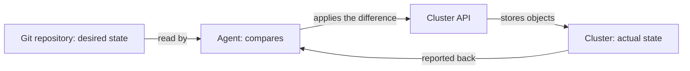

# Desired State Versus Imperative Steps

A team runs the `scout` service in the namespace `starfleet-staging`. Today a person types `kubectl` commands to create it. Tomorrow the same person has to change it, and a month later another person has to rebuild it after a mistake. This part explains the difference between describing the result and listing the steps, and why GitOps chooses the description.

## Two ways to say the same thing

An **imperative** instruction names an action: create a namespace, create a Deployment, scale it to one replica, expose it. The result depends on the order of the steps and on what already exists. If the namespace exists, the first step fails. If the Deployment was scaled by someone else, the third step changes it again without any record of why.

A **declarative** description names the end state: a namespace `starfleet-staging` exists, and in it a Deployment `scout` with one replica of one image, and a Service in front of it. The description does not say how to get there. A program compares the description with what exists and works out the difference. Running the program a second time with no change in the description does nothing.

The playground repository contains both forms. The file `scripts/deploy.sh` is a list of `kubectl create` commands. The folders `base` and `overlays` hold the Kubernetes manifests of the same workload. The script is correct only on an empty cluster, and the manifests are correct on any cluster.

## What a manifest declares

A Kubernetes manifest is a YAML file that describes one object. Its `spec` field is the desired state, and its `status` field is what the cluster reports. The Deployment `scout` says in `spec.replicas` how many pods should run. The Deployment controller, a program inside Kubernetes, creates or removes pods until the count matches. Kubernetes was already declarative before GitOps existed: the cluster stores the desired state and controllers close the gap.

GitOps adds a second layer on top. The desired state of the whole cluster lives in a Git repository, and a second program reads the repository and makes the cluster match it. Git is the place where a person states what should be true, and the cluster is the place where it is made true.



The agent in this module is Argo CD. It does not run commands from a script. It reads manifests, asks the cluster what exists, and applies only the objects that differ.

## Why the description is safer

A description can be repeated without harm. A person who runs a script twice may create duplicates or get an error halfway, and the cluster then holds a state that neither the script nor any file describes. A program that compares two states can be run after every failure and still end in the same place.

A description can also be reviewed before it runs. A reviewer reads the difference between two versions of the file and sees which image changes, which replica count changes and which setting disappears. A list of commands shows the actions, and the reviewer has to guess the result.

A description answers the question "what should exist now?" at any time. For the script, that question has no answer: the script says what was done once, not what must stay true. After a person edits the live Deployment, nothing in the script shows that the cluster no longer matches.

## Where the line is blurry

Storing files in Git does not make them declarative. A repository that holds `deploy.sh` has history and review, and it is still a list of steps. The test is what the file contains: a statement of the result, or a sequence of actions.

Some declarative files still contain a step. A Kubernetes Job that runs a database migration is an object that says "this task should have run". Whether that is acceptable depends on whether the task is safe to run more than once and on how the agent treats a finished Job. This module treats such cases as exceptions that need a written reason.

## Try it: compare the script and the declaration

The playground has Argo CD, a Git server and the repository `scout-deploy`. Paste the helper functions from the playground overview into your terminal. Then clone the repository and read the script:

<!-- astrona:playground:renew -->

```sh
git_clone
cd scout-deploy
cat scripts/deploy.sh
```

The script has four commands. Now render the staging overlay without applying anything. `kubectl kustomize` reads a folder with a `kustomization.yaml` file and prints the final manifests:

```sh
kubectl kustomize overlays/staging
```

The output is a Deployment and a Service in the namespace `starfleet-staging`, with the image tag `6.15.0` and one replica. Nothing exists in the cluster yet. Check that:

```sh
kubectl get namespace starfleet-staging
```

The cluster answers that the namespace is not found. Now give the declaration to Argo CD. Save this as `application-scout-staging.yaml`:

```yaml
apiVersion: argoproj.io/v1alpha1
kind: Application
metadata:
  name: scout-staging
  namespace: argocd
spec:
  project: default
  source:
    repoURL: http://gitea-http.gitea.svc:3000/starfleet/scout-deploy.git
    targetRevision: main
    path: overlays/staging
  destination:
    server: https://kubernetes.default.svc
    namespace: starfleet-staging
  syncPolicy:
    automated: {}
    syncOptions:
      - CreateNamespace=true
```

The `Application` is itself a declaration. It says that the path `overlays/staging` of the branch `main` should exist in the namespace `starfleet-staging` of the cluster where Argo CD runs. Apply it and check the status:

```sh
kubectl apply -f application-scout-staging.yaml
app_status
```

After a short time the `Application` shows `Synced` and `Healthy`. Check the workload and the Service:

```sh
kubectl -n starfleet-staging get deployment,service scout
kubectl -n starfleet exec deploy/shuttle -- curl -s http://scout.starfleet-staging/
```

The answer from `scout` is a JSON document that contains `"message": "staging"`, the value from the overlay.

Now try the first step of the script by hand. Argo CD already created the namespace, so the imperative step has nothing left to do:

```sh
kubectl create namespace starfleet-staging
```

The command fails because the namespace exists. A declaration has no such failure: it says the namespace should exist, and it does.

## Common pitfalls

> [!WARNING]
> A script in a Git repository is still a list of steps. Version control gives history and review, not a declared end state. Check what the file says: a result that must stay true, or actions that were done once.
