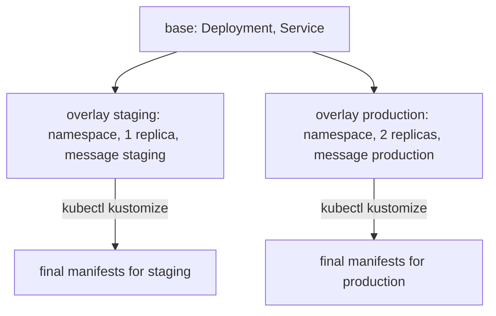

# Sufficient Intent And Rendering

The `scout` Deployment needs an image, a replica count, a port, a probe and a namespace. A repository that names only the application does not say enough for anything to run. This part explains what makes a declaration sufficient, how Kustomize builds the final manifests from smaller pieces, and where Argo CD does that work.

## Sufficient means complete within its scope

A declaration is sufficient when everything that decides the behaviour of the workload is either written in the repository or named as an assumption. For `scout` the decisions are the image and its version, the number of replicas, the resource requests and limits, the environment values, the namespace and the Service that exposes it.

A missing value is not an error in Kubernetes. If the manifest has no `replicas`, the API server fills in the default of `1`. If it has no resource limit, the container has no limit. The result runs, but the repository no longer says what the operator relies on. When the default changes or someone else sets a limit through a policy, the behaviour changes without a commit.

The rule for authors is to write down every value that matters to the behaviour, and to name the platform defaults that are accepted on purpose. A default that the team relies on is part of the declaration even when it is not written in the file.

## Rendering: from small pieces to final manifests

Most teams do not write each environment as a full copy. They keep one common description and a small description of each difference. **Rendering** is the step that combines them into the concrete manifests that are applied.

Kustomize is a renderer built into `kubectl`. A folder with a `kustomization.yaml` file is a **base** when it holds the common objects. An **overlay** is another folder that lists the base as a resource and adds changes. In the playground repository the base holds a Deployment and a Service, and the overlays `staging` and `production` add a namespace, a label, an image tag, a replica count and a patch that sets the message.



The overlay `kustomization.yaml` holds four kinds of change. `namespace` sets the namespace of every object. `labels` adds labels. `images` replaces the tag of an image by name, so the base can keep a neutral image reference. `replicas` sets the count for a named Deployment. A `patches` entry points at a file with a partial manifest that is merged into the object with the same kind and name.

Rendering is a function from files to manifests. The same files and the same tool version give the same output. That is what lets a reviewer trust a diff of the overlay: the diff is a change of the input of a deterministic step.

## Where rendering inputs hide

The output depends on every input of the render, not only on the files in the folder. A Kustomize resource can name a remote base by URL. If the URL points at a branch, the base changes when someone pushes to that branch, and the overlay renders differently without a commit in this repository. A Helm chart can have a dependency range that resolves to a newer version later. The tool version also matters, because a newer release can change defaults.

For this reason a remote base is referenced by a commit or an exact version, and the renderer version is part of what the team tracks. Argo CD renders inside its repository server component, so the Kustomize version that matters is the one built into that component, not the one on a laptop.

## Where Argo CD renders

The Argo CD **repository server** clones the repository, finds the `path` of the `Application`, detects the kind of source and renders it. A folder with a `kustomization.yaml` is rendered as Kustomize. A folder with a `Chart.yaml` is rendered as Helm. A folder with plain YAML files is read as it is. The result is a list of manifests that the **application controller** compares with the live objects.

If rendering fails, nothing is compared. The `Application` shows a condition of the type `ComparisonError` with the text of the error, and the workload stays as it was. This is the first place to look when a commit seems to have no effect.

## Rendering is not a script

Rendering can look like a procedure, because it has steps inside. It is still declarative when the inputs are the description and the output is the same each time. The test is that nothing in the render changes the cluster or depends on its state. A render that reads a value from the live cluster during the build, for example a lookup of a Secret, is not a pure function of the repository, and the repository no longer describes the result alone.

## Try it: change the declaration and break it

The playground has the `Application` from the previous part only if you created it. If you start fresh, create it again from the file `application-scout-staging.yaml` and wait for `Synced`.

<!-- astrona:playground:renew -->

Clone the repository, change the staging message and push:

```sh
git_clone
cd scout-deploy
sed -i.bak 's/value: staging/value: staging-two/' overlays/staging/message.yaml
rm overlays/staging/message.yaml.bak
git commit -am "Staging message: staging-two"
git push origin main
```

Argo CD checks the repository about every three minutes. Ask for the check now, then read the message from the service:

```sh
app_refresh scout-staging
kubectl -n starfleet exec deploy/shuttle -- curl -s http://scout.starfleet-staging/
```

After the rollout the answer contains `"message": "staging-two"`. The commit is the only change that was made: the live Deployment was never edited by hand.

Now break the render. Rename the patch file so that the `kustomization.yaml` points at a file that does not exist:

```sh
git mv overlays/staging/message.yaml overlays/staging/message-renamed.yaml
git commit -am "Rename the patch file"
git push origin main
app_refresh scout-staging
```

Read the condition of the `Application`:

```sh
kubectl -n argocd get application scout-staging -o jsonpath='{.status.conditions[*].type}{"\n"}{.status.conditions[*].message}{"\n"}'
```

The type is `ComparisonError`, and the message says that the kustomization cannot read the file. The running pods are untouched, and the service still answers with the old message. Fix the file name, push again and refresh:

```sh
git mv overlays/staging/message-renamed.yaml overlays/staging/message.yaml
git commit -am "Restore the patch file name"
git push origin main
app_refresh scout-staging
app_status
```

The `Application` returns to `Synced`.

## Common pitfalls

> [!WARNING]
> A value that is not written down is still a value. Platform defaults, remote bases that follow a branch and unpinned chart dependencies change the output without a commit. Pin the inputs of the render and name the defaults you rely on.
