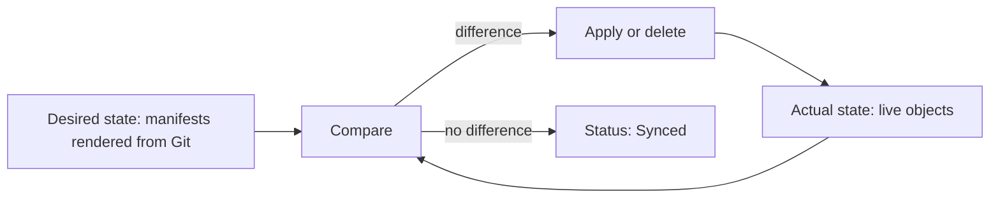

# Controllers, Ownership And Pruning

A declaration says what should exist. Something must read it, compare it with the cluster and act on the difference. That something is a controller. This part explains how a controller works, how Argo CD marks the objects it owns, and what happens to an object when its manifest leaves the repository.

## The control loop

A **controller** is a program that repeats three steps. It reads the desired state, it reads the actual state, and it acts to reduce the difference. Then it starts again. It does not remember a list of commands. It only needs the two states and a rule for each kind of difference.

Kubernetes has many controllers. The Deployment controller keeps the right number of pods. The Service machinery keeps the endpoints of a Service in line with matching pods. Argo CD adds one more, the **application controller**, whose desired state is a Git revision and whose actual state is the live objects in a destination namespace.



The loop gives two properties that a script does not have. It converges: after a failure or an outside change it takes the next pass and moves toward the same end. And it is idempotent: an extra pass with no difference does nothing.

## How Argo CD knows what it owns

A cluster contains objects from many sources: Kubernetes itself, other controllers, other teams and people with `kubectl`. Argo CD must not touch an object that its `Application` did not create. It marks the objects it applies with a **tracking** annotation, `argocd.argoproj.io/tracking-id`. The value contains the name of the `Application`, the group, the kind, the namespace and the name of the object.

When the application controller compares the state, it looks for live objects that carry its tracking value. An object in the destination namespace without the value is not part of the application. An object whose manifest is in the repository, but which has no live twin, is shown as missing. An object that carries the value but whose manifest is no longer in the repository is an orphan, and the next section explains what Argo CD does with it.

The tracking annotation is itself part of the live object, and it is written by the sync. Copying a live object into the repository with its annotations carries a value that belongs to the live state. Manifests in the repository should not contain it.

## What pruning removes

When a file leaves the repository, the declaration no longer includes that object. The live object still exists. **Pruning** is the step that deletes live objects that are tracked by an `Application` and are not in the rendered manifests.

With a manual sync, pruning is a choice for each sync. With automated sync, the `prune` setting decides whether the controller deletes orphans by itself. The default is `false`. Without it, the `Application` shows the orphan as `OutOfSync` with the note that it requires pruning, and nothing is deleted until someone runs a sync with pruning. Argo CD also refuses to prune when the rendered result is empty, unless the `Application` allows it, which protects the cluster from a broken render that produces no manifests.

The reason to prune is that a declaration is a complete description. If a deleted file leaves its object behind, the repository and the cluster disagree, and the cluster holds something that no reviewer can see in Git. The reason to be careful is the opposite: some objects are not safe to delete when the file goes. A persistent volume claim holds data. The annotation `argocd.argoproj.io/sync-options: Prune=false` on an object tells Argo CD never to prune it.

## Ownership of a single field

An object can have more than one owner. A Horizontal Pod Autoscaler changes the replica count of a Deployment while Argo CD owns the rest of its `spec`. If the repository also sets `replicas`, the two controllers write different values and take turns. A declarative file does not decide this: the teams decide it. Either one controller owns the field, or the other controller is told to leave it alone. The module on reconciliation shows the Argo CD setting for the second case.

## Deleting the Application

Deleting an `Application` object does not delete its workload by default. The objects keep running and lose their owner. If the `Application` has the finalizer `resources-finalizer.argocd.argoproj.io`, Argo CD deletes the tracked objects first and the `Application` after that. The finalizer is the explicit statement that the lifecycle of the workload follows the lifecycle of its declaration.

## Try it: see the tracking value and prune an orphan

Start with an `Application` that has automated sync and no `prune`. Save this as `application-scout-staging.yaml` and apply it:

<!-- astrona:playground:renew -->

```yaml
apiVersion: argoproj.io/v1alpha1
kind: Application
metadata:
  name: scout-staging
  namespace: argocd
spec:
  project: default
  source:
    repoURL: http://gitea-http.gitea.svc:3000/starfleet/scout-deploy.git
    targetRevision: main
    path: overlays/staging
  destination:
    server: https://kubernetes.default.svc
    namespace: starfleet-staging
  syncPolicy:
    automated: {}
    syncOptions:
      - CreateNamespace=true
```

```sh
kubectl apply -f application-scout-staging.yaml
app_status
```

Read the tracking value on the Deployment:

```sh
kubectl -n starfleet-staging get deployment scout -o jsonpath='{.metadata.annotations.argocd\.argoproj\.io/tracking-id}{"\n"}'
```

The value starts with `scout-staging:apps/Deployment:starfleet-staging/scout`. Now add a ConfigMap to the base. Clone the repository and save this as `base/banner.yaml`:

```sh
git_clone
cd scout-deploy
cat > base/banner.yaml <<'YAML'
apiVersion: v1
kind: ConfigMap
metadata:
  name: banner
data:
  text: hello
YAML
```

Rewrite `base/kustomization.yaml` so that it lists the new file, then commit, push and check:

```sh
cat > base/kustomization.yaml <<'YAML'
apiVersion: kustomize.config.k8s.io/v1beta1
kind: Kustomization
resources:
  - deployment.yaml
  - service.yaml
  - banner.yaml
labels:
  - pairs:
      app.kubernetes.io/part-of: starfleet
YAML
git add -A
git commit -m "Add the banner ConfigMap"
git push origin main
app_refresh scout-staging
kubectl -n starfleet-staging get configmap banner
```

The ConfigMap exists. Now remove the file and its entry again, commit and push:

```sh
git rm base/banner.yaml
cat > base/kustomization.yaml <<'YAML'
apiVersion: kustomize.config.k8s.io/v1beta1
kind: Kustomization
resources:
  - deployment.yaml
  - service.yaml
labels:
  - pairs:
      app.kubernetes.io/part-of: starfleet
YAML
git add -A
git commit -m "Remove the banner ConfigMap"
git push origin main
app_refresh scout-staging
app_status
kubectl -n starfleet-staging get configmap banner
```

The `Application` shows `OutOfSync`, and the ConfigMap is still there. Now turn pruning on by patching the `Application`:

```sh
kubectl -n argocd patch application scout-staging --type merge -p '{"spec":{"syncPolicy":{"automated":{"prune":true}}}}'
kubectl -n starfleet-staging get configmap banner
```

After a short time the ConfigMap is gone and the `Application` is `Synced`. The sync found an object with the tracking value that no manifest described, and deleted it.

## Common pitfalls

> [!WARNING]
> Pruning deletes what the repository no longer describes. Data-holding objects such as persistent volume claims need `Prune=false` or a separate lifecycle. A field that two controllers write needs one owner, and a deleted `Application` leaves its workload behind unless the finalizer is set.
