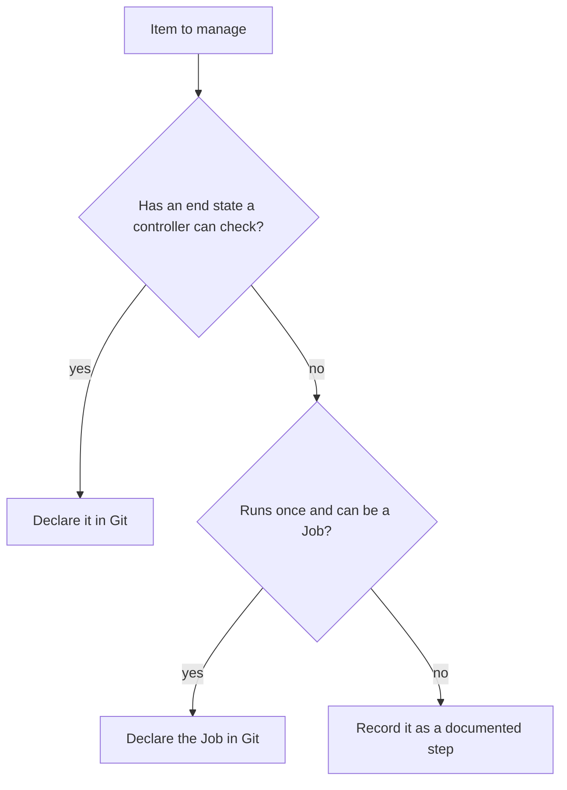

# Where Imperative Steps Still Fit

A declared state describes what should exist. Some work is not a state: running a data migration, creating the first cluster, restoring a backup. This part explains what a declaration can and cannot hold, how to keep one-off actions out of the way of the loop, and how a team decides whether something belongs in the repository.

## What a declaration is good for

A declaration works for things that have a stable end state that a controller can check: a Deployment with three replicas, a Service, a ConfigMap, a policy object. The controller can read the object, compare it with the file and repeat the check forever.

Data is different. The rows in a database, the contents of a volume and the messages in a queue change all the time, and no file in Git can say what they should be. The declaration can describe the database server and its storage, but not the data in it. A backup and a restore are procedures that act on data.

## Actions that run once

A **one-off action** is a step that must run once and then stop: a schema migration, a seed job, a certificate request done by hand. Two safe ways exist to model these.

The first is a Kubernetes `Job` kept in the repository. The Job is a declared object. Its result is not a state that is checked again, so the sync runs it when it is created and the history shows when it was added. In Argo CD a Job can also run as a hook before or after a sync, which a later module covers.

The second is a manual step outside the loop, recorded in a runbook or a ticket. This is fine for actions with a human decision in them, but the record must exist, because the cluster will not show that the action happened.

## What the controller leaves alone

Argo CD acts only on objects it tracks. An object created by hand with `kubectl` has no tracking annotation, so the comparison ignores it and pruning does not delete it. This protects a one-off Job that someone started in a namespace that an `Application` manages. It also means the repository no longer describes everything that runs there.

```sh
kubectl -n starfleet-staging get all -o name
kubectl -n starfleet-staging get deploy scout -o jsonpath='{.metadata.annotations.argocd\.argoproj\.io/tracking-id}{"\n"}'
```

The second command prints the tracking value of an object that Argo CD applied. An object made by hand prints an empty value.

## A rule for the repository

A useful test is the question: if this cluster is rebuilt from the repository alone, is this item present? If the answer must be yes, it belongs in the declaration. If it must be yes for the server but not for the data, declare the server and keep the data in a backup. If the item is a one-off action, declare it as a Job or record it as a documented step.



## Try it: an object that the loop does not own

<!-- astrona:playground:renew -->

Create an `Application` with automated sync and prune for the staging overlay, as in the earlier parts, and wait until it is `Synced`. Then create an object by hand in the same namespace:

```sh
kubectl -n starfleet-staging create configmap manual-note --from-literal=text=made-by-hand
app_status
kubectl -n starfleet-staging get configmap manual-note -o jsonpath='{.metadata.annotations}{"\n"}'
```

The `Application` stays `Synced`. The ConfigMap has no tracking annotation, so Argo CD neither compares nor prunes it. Delete it again with `kubectl -n starfleet-staging delete configmap manual-note`. The cluster now matches the repository again, which is what a declaration promises.

## What you know now

A declaration holds states that a controller can check. Data and one-off actions need another route: a declared Job, or a recorded manual step. Argo CD leaves untracked objects alone, so a hand-made object is invisible to the loop. The test for membership in the repository is whether a rebuilt cluster must contain the item.

## Common pitfalls

> [!WARNING]
> Objects created by hand in a managed namespace are not part of the declaration. They survive a prune and they disappear when the namespace is rebuilt. Treat them as drift of a kind the tool cannot see.
