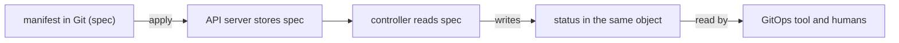

# Spec, Status And The Declarative API

Every GitOps tool depends on one property of Kubernetes: the API stores what you want separately from what exists. This part explains that split, shows which fields belong to which side, and explains why a manifest in Git may only describe one of them.

## One object, two halves

A Kubernetes object has four top-level parts. `apiVersion` and `kind` say which type it is. `metadata` holds the name, the namespace, labels and annotations. `spec` holds the desired state. Most types also have `status`, which holds the observed state.

The `spec` belongs to the user. A person or a tool writes it, and the API server stores it. The `status` belongs to the controller of that type. The Deployment controller counts the pods it manages and writes the numbers into `status.replicas`, `status.readyReplicas` and `status.conditions`. A user does not write `status`.

This split is the reason a manifest in Git contains only `spec` and metadata. The repository describes what should be true. The cluster reports what is true. Argo CD compares the two when it decides whether an `Application` is `OutOfSync`, and it ignores `status` for that comparison.

## How the API tells you a change was seen

When you change the `spec`, the API server raises the number `metadata.generation`. A controller copies the generation it has handled into `status.observedGeneration`. If the two numbers differ, the controller has not yet reacted to the latest change. This is how a tool can tell "the change is still being processed" from "the change was processed and failed".

Read both numbers for the Deployment `scout` with this command:

```sh
kubectl -n starfleet-staging get deployment scout -o jsonpath='{.metadata.generation} {.status.observedGeneration}{"\n"}'
```

When the numbers are equal, the controller has seen the current `spec`. The conditions in `status.conditions` then say whether the rollout is complete. `Available` says enough pods are ready. `Progressing` says the rollout is moving or has finished.

## Imperative commands and object configuration

`kubectl` has two styles. In the imperative style, a command names an action: `kubectl create deployment`, `kubectl scale`, `kubectl set image`, `kubectl delete`. Each command changes the live object directly, and nothing records the intended end state.

In the declarative style, you keep a file that describes the object and run `kubectl apply -f` on it. The file is the record. The same file can be reviewed, versioned and applied again. This is the style that fits Git, because the file in the repository can be the source of truth.



The diagram shows that the spec flows from Git to the controller and the status flows back as observation.

## Fields that someone else fills in

Some `spec` fields are filled in by the system when you leave them out. The API server sets a Service `clusterIP`. The Deployment defaults add a `strategy` and a `revisionHistoryLimit`. An admission webhook can add a sidecar container or a label. These values are in the live object and not in Git.

A GitOps tool has to handle this. Argo CD normalises the live object and the rendered manifest before it compares them, and it ignores some well-known defaulted fields. When a controller or a webhook keeps changing a field you did declare, the `Application` shows a permanent difference. Section 040 explains how to ignore such a field on purpose.

## Try it: read the two halves

Start the playground. Create a Deployment from a file and read its halves.

<!-- astrona:playground:renew -->

```sh
git_clone
kubectl create namespace starfleet-staging
kubectl apply -k scout-deploy/overlays/staging
kubectl -n starfleet-staging get deployment scout -o yaml
```

Find `spec.replicas`, which you declared, and `status.readyReplicas`, which the controller wrote. Find fields in `spec` that you did not write, such as `strategy` and `progressDeadlineSeconds`. These came from API defaults.

Now scale by hand and watch the two numbers:

```sh
kubectl -n starfleet-staging scale deployment scout --replicas=2
kubectl -n starfleet-staging get deployment scout -o jsonpath='{.metadata.generation} {.status.observedGeneration}{"\n"}'
```

The generation rose by one when the `spec` changed. After the controller reacts, `observedGeneration` catches up. The scale command changed the live `spec` without a file, so the cluster no longer matches Git. That is the difference an `Application` would report as `OutOfSync`.

## What you know now

The `spec` is the declaration, the `status` is the report, and the API server keeps both in one object. A tool that manages objects from Git writes only the `spec`, and it reads the `status` to know whether the result worked. The next question is how a file becomes a live object, and what happens when the object already exists.

## Common pitfalls

> [!WARNING]
> A manifest exported with `kubectl get -o yaml` contains `status`, `resourceVersion`, `uid` and `managedFields`. Do not commit an export as a declaration. Remove the server-written fields first.
