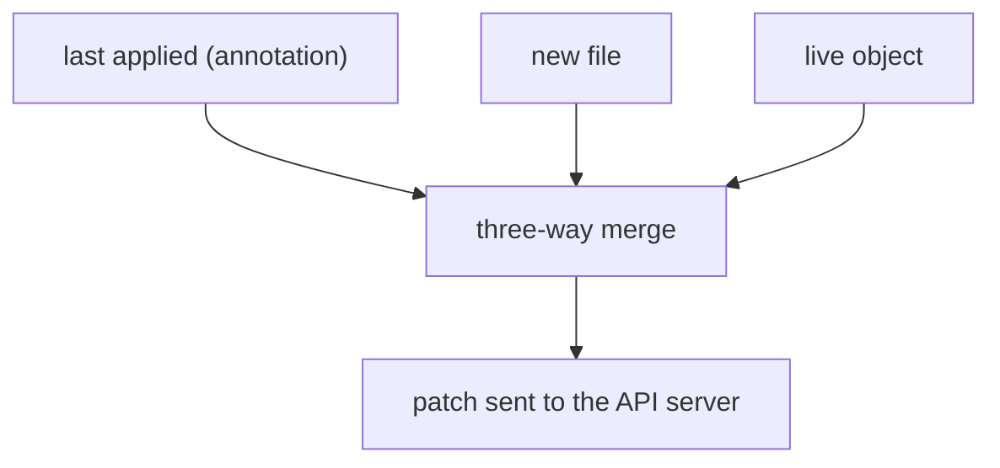

# Create, Apply, Replace And Idempotence

A pipeline runs the same step many times. For that to be safe, running the step twice must give the same result as running it once. This part compares three `kubectl` commands that write an object, and explains how `kubectl apply` merges a file into an object that already exists.

## Idempotence

An operation is **idempotent** when repeating it with the same input leaves the system in the same state as running it once. A declaration is idempotent by nature, because it states an end state. A procedure is not, because each run can add something: a second `kubectl create` has nothing new to add and fails.

GitOps relies on this property. A controller applies the desired state every time it compares and finds a difference, and it can do so after a restart, after a failure and after a retry. If each application of the same manifest changed something, the loop would never settle.

## Three ways to write an object

`kubectl create -f` sends a create request. If an object with that name already exists, the API server rejects the request with an `AlreadyExists` error. The command is not idempotent.

`kubectl replace -f` sends a replace request. It overwrites the whole object with the file. The object must already exist. Fields that are in the live object and not in the file are removed. If the file holds a `resourceVersion`, the API server rejects the write when the object changed in between.

`kubectl apply -f` creates the object when it does not exist and updates it when it does. It changes only the fields that the file names and fields that the file used to name. Running it twice with the same file prints `unchanged` for the second run.

## How client-side apply merges

By default, `kubectl apply` uses client-side apply. Each time it applies a file, it stores the file in the annotation `kubectl.kubernetes.io/last-applied-configuration` on the object. On the next apply, `kubectl` makes a three-way comparison between the last applied file, the new file and the live object.

The rules follow from the three inputs. A field that is in the new file is set. A field that was in the last applied file and is no longer in the new file is removed. A field that is only in the live object, for example one written by a controller or by `kubectl scale`, is left alone.

This explains a common surprise. If `replicas` is not in your file, a manual `kubectl scale` survives an apply. If `replicas` is in your file, the apply sets it back. For lists, such as the `containers` list, the merge uses a key: the container `name`.



## Preview before you write

Two options show the result without changing the object. `kubectl diff -f file.yaml` prints the difference between the file and the live object. `kubectl apply --dry-run=server -f file.yaml` sends the request to the API server, runs validation and admission, and does not store the result. The client-side dry run, `--dry-run=client`, does not contact the server for admission, so it can accept a file that the server rejects.

## What Argo CD does

Argo CD applies manifests like `kubectl apply` by default. It also marks each object with a tracking annotation so it can find the objects that it owns. The sync option `Replace=true` makes it use replace instead, which is needed for objects that are too large for the last-applied annotation. The sync option `ServerSideApply=true` makes it use server-side apply, which the next part explains.

## Try it: apply twice, then create

<!-- astrona:playground:renew -->

```sh
git_clone
kubectl create namespace starfleet-staging
kubectl apply -k scout-deploy/overlays/staging
kubectl apply -k scout-deploy/overlays/staging
```

The second run reports each object as `unchanged`. The command is idempotent. Now render the overlay to a file and use `create`:

```sh
kubectl kustomize scout-deploy/overlays/staging > staging.yaml
kubectl create -f staging.yaml
```

The API server rejects the objects with `AlreadyExists`. Next, see the three-way rule. Scale by hand, remove nothing from the file, and apply again:

```sh
kubectl -n starfleet-staging scale deployment scout --replicas=3
kubectl apply -f staging.yaml
kubectl -n starfleet-staging get deployment scout -o jsonpath='{.spec.replicas}{"\n"}'
```

The file declares `replicas: 1`, so the apply sets it back to 1. Last, read the stored annotation:

```sh
kubectl -n starfleet-staging get deployment scout -o jsonpath='{.metadata.annotations.kubectl\.kubernetes\.io/last-applied-configuration}'
```

The annotation holds the file that `kubectl` applied. It is the second input of the three-way merge.

## What you know now

Create fails on a second run, replace overwrites everything, and apply merges. Apply is the command that makes a file a declaration, and its merge rules decide which fields the file owns. Two writers that both want a field raise a harder question, which the next part answers.

## Common pitfalls

> [!WARNING]
> Mixing `kubectl create` and `kubectl apply` on the same object leaves it without the last-applied annotation. The first apply after a create may then not remove fields that you deleted from the file.
