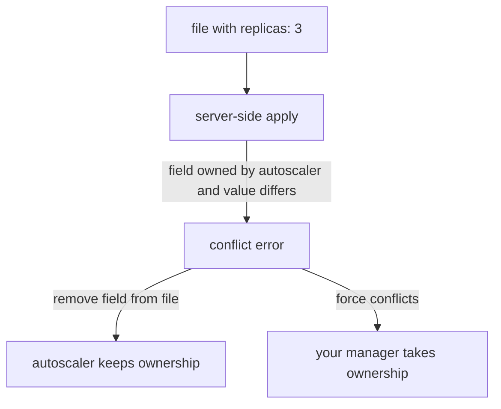

# Server-Side Apply And Field Managers

Client-side apply keeps its merge state in an annotation and cannot say who owns a field. When a Git-driven controller and another controller both write the same object, that is not enough. This part explains server-side apply, which moves the merge into the API server and records an owner for every field.

## The problem with one shared object

A Deployment can have several writers. Argo CD sets the container image. A horizontal pod autoscaler sets the replica count. A policy engine adds a label. If every writer sends a full or partial patch, the last write wins and nobody knows who changed what.

**Server-side apply** solves this by tracking ownership. The API server keeps a record of which writer set each field, and it refuses a change that would take a field from another owner unless the writer says it is intended.

## Field managers and managedFields

A **field manager** is a name that identifies a writer. `kubectl apply --server-side` uses the name `kubectl` unless you set `--field-manager=name`. Argo CD uses the name `argocd-controller` for its server-side applies.

The API server stores the ownership in `metadata.managedFields`. Each entry has a manager name, an operation (`Apply` or `Update`), the time and a set of field paths. `kubectl get` hides this list by default. Show it with the flag `--show-managed-fields`.

An `Apply` entry means the manager sent a full declaration of the fields it cares about. An `Update` entry means the manager changed fields with an ordinary update, such as `kubectl scale`. Both kinds mark ownership of the fields they set.

## What a conflict is

Suppose the autoscaler owns `spec.replicas` and you apply a file that sets `replicas: 3` with server-side apply. The API server compares the value in your file with the live value and checks the owner. If the values differ and another manager owns the field, the request fails with a conflict. The error names the field and the manager that owns it.

There are two ways to resolve a conflict. Remove the field from your file, so that you no longer claim it. Or send the request with `--force-conflicts`, which takes ownership of the field. The first choice is the safer one when another controller is meant to own the field. The second makes sense when your file is the authority and the other writer was a mistake.



## Removing a field

With server-side apply, a field that a manager owned in its last apply and leaves out of the next one is removed from the object, if no other manager owns it. This replaces the last-applied annotation with a stored list of paths. It also means one manager can remove its own fields without touching the fields of others.

## Server-side apply in Argo CD

Set the sync option `ServerSideApply=true` on an `Application`, or per object with the annotation `argocd.argoproj.io/sync-options: ServerSideApply=true`. Argo CD then sends each manifest as a server-side apply with the manager `argocd-controller`. This helps with very large objects such as CustomResourceDefinitions, which exceed the size limit of the last-applied annotation, and with objects that share fields with other controllers.

## Try it: two writers

<!-- astrona:playground:renew -->

```sh
git_clone
kubectl create namespace starfleet-staging
kubectl kustomize scout-deploy/overlays/staging > staging.yaml
kubectl apply --server-side --field-manager=gitops -f staging.yaml
kubectl -n starfleet-staging scale deployment scout --replicas=3
kubectl -n starfleet-staging get deployment scout -o yaml --show-managed-fields
```

Read the `managedFields` list. The manager `gitops` has an `Apply` entry. The manager `kubectl` has an `Update` entry for `spec.replicas`, because the scale command is a plain update. Now apply the file again with the same manager:

```sh
kubectl apply --server-side --field-manager=gitops -f staging.yaml
```

The API server reports a conflict on `spec.replicas`, because the file says 1, the live value is 3, and the manager `kubectl` owns the field. Resolve it by taking ownership:

```sh
kubectl apply --server-side --field-manager=gitops --force-conflicts -f staging.yaml
kubectl -n starfleet-staging get deployment scout -o jsonpath='{.spec.replicas}{"\n"}'
```

The count is back to 1 and the manager `gitops` owns the field again.

## What you know now

Server-side apply gives every field an owner, turns silent overwrites into conflicts and lets several controllers share one object. Argo CD can use it through one sync option. Rendering the file that gets applied is a separate step, and the last part covers the two renderers that most repositories use.

## Common pitfalls

> [!WARNING]
> `--force-conflicts` takes fields away from other managers. Use it only when the file is meant to be the authority. Otherwise remove the field from the file or use an ignore rule in Argo CD.
