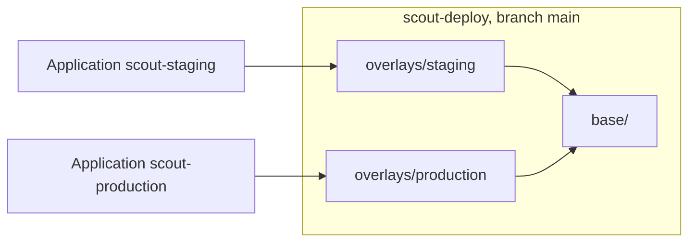

# Repository Structure And Environments

Declared state has to live somewhere that people can review and the agent can read. How that place is organised decides how easy it is to change one environment without touching another. This part compares the common layouts and gives the reasons that GitOps guidance prefers some of them.

## Application repository and configuration repository

An **application repository** holds source code and the build. A **configuration repository** holds the declared state of the deployment: manifests, charts, overlays and values. Teams often keep the two apart. The reasons are practical. A code change triggers a build, while a deployment change should not. Access differs, because many people write code and few approve a production change. The history of the configuration repository then reads as a list of deployments, without the noise of code commits.

A small team may keep both in one repository. This works if the folder for deployment files is clearly separated, and if a code commit cannot change production by accident.

## One repository or many

A **monorepo** keeps all applications and environments in one repository. It gives one place to search and one review process, and a single commit can change several applications together. It also gives one set of permissions for everything in it.

**Several repositories**, for example one per team, give separate permissions and separate histories. They make cross-cutting changes harder, because one change becomes several pull requests.

Argo CD and Flux work with both. The `Application` points at a repository and a path, so the choice is a team decision and not a tool limit.

## Folders or branches for environments

Two patterns appear for environments.

In the **folder pattern**, one branch holds a folder per environment, for example `overlays/staging` and `overlays/production`. A change to production is a change to a file in that folder. The difference between environments is visible by comparing two folders.

In the **branch pattern**, each environment has its own branch, and a change is promoted by merging from one branch to the next. This looks simple, but the branches drift. Merges bring unwanted differences, a hotfix on one branch is forgotten on another, and a reader cannot see what differs without a diff of the branches.

Most guidance prefers folders on one branch, because the whole declared state can be read at one commit and a promotion is an explicit edit. Branches can still be useful for review, as short-lived branches that become pull requests.



## One Application per environment

Each environment is usually its own `Application` with its own path and destination namespace. This gives separate sync status, separate sync policy and separate history. Staging can use automated sync while production waits for a person.

## Try it: read the layout

<!-- astrona:playground:renew -->

```sh
git_clone
cd scout-deploy
find . -path ./.git -prune -o -type f -print | sort
```

The list shows `base/` with the shared manifests and one folder per environment under `overlays/`. Compare how the two environments differ:

```sh
diff overlays/staging/kustomization.yaml overlays/production/kustomization.yaml
```

Only the namespace, the label, the replica count and similar settings differ. Everything else comes from the base.

## What you know now

A configuration repository separates deployment state from code. A monorepo and several repositories both work. Folders per environment on one branch keep the whole state readable, and branches per environment tend to drift. One `Application` per environment keeps status and policy separate.

## Common pitfalls

> [!WARNING]
> Environments kept on separate long-lived branches need merges to stay aligned, and every unnoticed difference is a hidden change. Prefer a folder per environment unless there is a strong reason.
