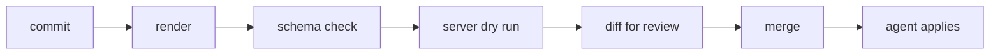

# Validating Declarations Before Merge

A declaration that reaches the main branch is applied by the agent. A mistake found after the merge is a mistake found in the cluster. This part lists the checks a team can run on a change before it merges, from rendering on a laptop to dry runs against a cluster.

## Level 1: does it render

The first check is that the tool can build the manifests. For Kustomize:

```sh
kubectl kustomize overlays/production > /dev/null && echo rendered
```

A missing file, a wrong path or a patch that matches no object makes this fail. For Helm, `helm template` does the same for a chart. A render failure in the cluster appears as a `ComparisonError` and changes nothing, but it blocks all later changes to that `Application`, so it is cheaper to catch it in review.

## Level 2: is it valid YAML for the API

A rendered manifest can still have a wrong field name or type. Schema validation catches this without a cluster. Tools such as `kubeconform` check manifests against the published schemas of Kubernetes, and they can load the schemas of custom resources. Use the version of Kubernetes that the cluster runs.

## Level 3: will the API server accept it

A server-side dry run sends the objects through admission without storing them:

```sh
kubectl apply -k overlays/production --dry-run=server
```

This runs the real validation and the admission webhooks, so it finds policy violations and unknown kinds. It needs a cluster, but it does not change one.

## Level 4: what would change

`kubectl diff` shows the difference between the rendered state and the live state:

```sh
kubectl diff -k overlays/production
```

For an `Application`, the `argocd app diff` command compares the live state with a local path or a revision. These answer the question a reviewer asks: what will this commit do.

## Put the checks in the pull request

A team runs the checks in the pipeline of the pull request, so that a failing render or schema check blocks the merge. Review can then spend its time on intent. The checks do not replace the agent. They reduce the number of changes that fail after merge.



## Try it: catch a mistake before it merges

<!-- astrona:playground:renew -->

```sh
git_clone
cd scout-deploy
sed -i.bak 's/replicas:/replicaz:/' overlays/production/kustomization.yaml
kubectl kustomize overlays/production > /dev/null; echo "render exit: $?"
```

The render reports an error for the unknown field, or ignores the field and leaves the replica count unchanged. Check which one your version of the tool does, and then read the diff:

```sh
git diff --stat
```

Restore the file with `git checkout overlays/production/kustomization.yaml` and remove the backup file. The point is that a one-word typo is found in seconds on a laptop, and it would otherwise be found by the agent.

## What you know now

Four levels of check catch different mistakes: rendering, schema validation, a server-side dry run and a diff. They run in the pull request, before the merge, so the agent applies fewer broken changes.

## Common pitfalls

> [!WARNING]
> A render that succeeds can still produce a wrong result, such as a patch that silently matches nothing. Read the diff of the rendered output, not only the diff of the overlay.
