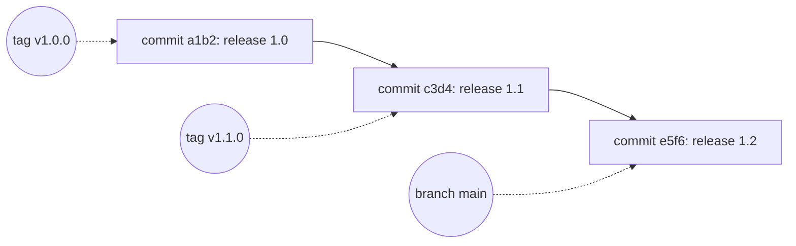

# Commits, Branches And Tags

The team releases `scout` as release 1.0, then 1.1, then 1.2. Someone asks which exact files ran in production last Tuesday. The answer exists only if the desired state has identifiable versions that do not change under the same name. This part explains how Git identifies a version, and which names in Git can move.

## A commit is a fixed record

A Git **commit** stores a snapshot of the files, a message, an author, a time and a pointer to its parent commit or commits. Git computes a hash from all of that content. The hash is the **commit ID**, a 40-character string of hexadecimal digits, for example `3f2a9c1...`. Two commits have the same ID only when their content, including the parent, is identical.

The parent pointer is part of the hashed content. A change to an old commit would change its hash, and with it the hash of every later commit. The chain of commits is therefore a record where tampering with one entry is visible in all later entries. This property is what **immutable** means in GitOps: a version with a given ID cannot be changed. A new version has a new ID.

Immutability holds for the content. It does not stop someone from deleting commits that are no longer reachable or from forcing a branch to point somewhere else. Those operations are possible in a repository, unless the server forbids them with a protection rule.

## Branches and tags are names

A **branch** is a name that points at one commit. When a new commit is added to the branch, the name moves to it. The branch `main` is the name of the newest commit on the main line. A **tag** is a name that points at one commit and is meant to stay there. Git allows a tag to be deleted and created again on another commit, and a server can allow a forced push of a tag.



The diagram shows three commits in a row and three names pointing at them. The tags stay on their commits. The branch `main` points at the newest one and moves forward with every commit.

A tag has two forms. A **lightweight** tag is only a name that points at a commit. An **annotated** tag is its own object with a message, an author and a time, and it points at the commit. Both are names, and the difference is only the extra information in the second.

## What Argo CD stores

The `Application` field `spec.source.targetRevision` is a name: a branch, a tag or a commit ID. Each time Argo CD checks the repository it **resolves** the name to a commit ID, and it renders the files of that commit. The result of the resolution is recorded in `status.sync.revision` of the `Application`.

Two values are therefore different: what the author wrote, which is a name, and what Argo CD evaluated, which is a commit ID. When the name is `main`, the evaluated commit changes whenever someone pushes. When the name is a commit ID, it never changes. When the name is a tag, it changes only if the tag is moved.

The status is the record to read in an incident. A report that says "production followed main" does not say which commit that was at a given time. The commit ID in `status.sync.revision` does.

## Names carry policy

Which name an environment follows is a policy decision. An environment that follows a branch receives every commit that reaches the branch, and the branch protection rules decide who may push there. An environment that follows a tag receives a change only when someone creates or moves a tag. An environment that follows a commit ID receives a change only when someone edits the `Application`.

Following a branch is convenient for a staging environment where fast feedback matters. Following a tag or a commit ID is common for production, because the release is a deliberate step with its own record.

## Try it: read the resolved revision

The playground repository `scout-deploy` has three commits. The first two have the tags `v1.0.0` and `v1.1.0`. The newest commit on `main` has no tag.

<!-- astrona:playground:renew -->

Save this as `application-scout-staging.yaml`. The `targetRevision` is the tag `v1.0.0`:

```yaml
apiVersion: argoproj.io/v1alpha1
kind: Application
metadata:
  name: scout-staging
  namespace: argocd
spec:
  project: default
  source:
    repoURL: http://gitea-http.gitea.svc:3000/starfleet/scout-deploy.git
    targetRevision: v1.0.0
    path: overlays/staging
  destination:
    server: https://kubernetes.default.svc
    namespace: starfleet-staging
  syncPolicy:
    automated: {}
    syncOptions:
      - CreateNamespace=true
```

Apply it and read the status:

```sh
kubectl apply -f application-scout-staging.yaml
app_status
```

The `REVISION` column shows a commit ID. Compare it with the commit that the tag points at in a clone of the repository:

```sh
git_clone
cd scout-deploy
git log --oneline --decorate
git rev-parse "v1.0.0^{commit}"
```

The log shows three commits, with the tags next to the first two and `main` next to the newest. The value of `git rev-parse` equals the revision of the `Application`. Check what runs:

```sh
kubectl -n starfleet exec deploy/shuttle -- curl -s http://scout.starfleet-staging/
```

The answer contains the message `release 1.0`. Now change the name that the `Application` follows from a tag to a branch:

```sh
kubectl -n argocd patch application scout-staging --type merge -p '{"spec":{"source":{"targetRevision":"main"}}}'
app_refresh scout-staging
app_status
```

The revision changes to the commit ID of the newest commit, and after the rollout the message is `release 1.2`. Compare the revision with the output of `git rev-parse main`. The same repository served three different states, and the only difference was the name in `targetRevision`.

## Common pitfalls

> [!WARNING]
> A tag is a name, not a guarantee. A tag can be deleted and created again on another commit unless the Git server forbids it. Record the commit ID that Argo CD evaluated, because a branch or tag name does not say which content ran.
