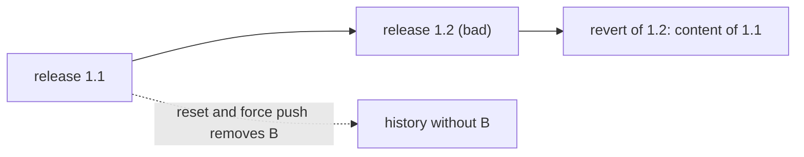

# Pinning, Rollback And Audit

Release 1.2 of `scout` is deployed and the pods do not become ready. The team must return to the last good state, and later it must show what happened and who approved it. This part explains how to pin a version, how to roll back so that the history stays intact, and where the audit trail lives.

## Pinning

To **pin** is to reference a version by something that does not move. For the desired state, the strongest pin is a commit ID in `targetRevision`. A tag works when the Git server stops anyone from moving it. A branch is not a pin.

The repository is only half of the input. The Deployment names a container image, and an image reference such as `podinfo:6.15.0` is a tag in a registry. A registry tag can be pushed again to another image. Two renders of identical Git content can then start different code. An image **digest**, a hash of the image content written as `image@sha256:...`, cannot point at another image. Pinning the repository and leaving the image as a movable tag leaves a gap in the record.

The recorded desired state and its dependencies should both be identified. The evidence for "what ran" is then the Git commit ID plus the image digests that the manifests named at that commit.

## Rollback is a new version

A rollback returns the cluster to an earlier state. There are two ways to describe it in GitOps. The first creates a **new commit** that restores the earlier content. `git revert <commit>` does this: it writes a commit whose change is the opposite of the named commit. The history then reads: release 1.1, release 1.2, revert of release 1.2. Every state that ever existed is still in the log, and the revert has its own author, message and time.

The second way **rewrites history**. A `git reset` to an earlier commit followed by a forced push moves the branch backwards and discards the newer commits from the branch. The repository then claims that release 1.2 never reached `main`. Clones and the Argo CD cache may still hold the removed commits, and the record of the failed release is gone from the place where people look for it. Rewriting history is a different operation and has a different risk: it erases the evidence.



The diagram shows the two options. The revert adds a commit after the bad one. The reset skips back and drops it.

## Argo CD has its own rollback

The Argo CD interface and command line also offer a rollback. It syncs the `Application` to a revision that is stored in the `Application` status. That list, `status.history`, holds the most recent deployments with their revision and time, ten by default through `spec.revisionHistoryLimit`. This kind of rollback changes the cluster without changing Git. Argo CD does not allow it while automated sync is on, because the next comparison would immediately move the cluster back to the branch.

In a GitOps workflow the repository is the source of truth, so a rollback is normally a Git change. The Argo CD history is useful as a record of what was synced and when, and as a quick way to inspect what ran before.

## Audit: three records

Three records answer the audit question. The Git log says who changed the desired state, when and with which message. A review system on top of Git says who approved the change. The `Application` status says which commit the cluster actually evaluated and when the last sync happened.

None of these records says whether the cluster has the content right now. For that the live state is compared with the desired state, which is a continuing job of the agent. Audit evidence connects four facts: the change, the approval, the evaluated commit and the result.

Access control is part of the audit. If anyone can push to `main` and move tags, the log shows what happened but the process did not prevent it. Branch protection, required reviews and a ban on forced pushes turn the log into enforced history.

## Try it: roll back with a revert

The playground starts with release 1.2 at the head of `main`. Create the `Application` with `targetRevision: main` and automated sync. Save this as `application-scout-staging.yaml`:

<!-- astrona:playground:renew -->

```yaml
apiVersion: argoproj.io/v1alpha1
kind: Application
metadata:
  name: scout-staging
  namespace: argocd
spec:
  project: default
  source:
    repoURL: http://gitea-http.gitea.svc:3000/starfleet/scout-deploy.git
    targetRevision: main
    path: overlays/staging
  destination:
    server: https://kubernetes.default.svc
    namespace: starfleet-staging
  syncPolicy:
    automated: {}
    syncOptions:
      - CreateNamespace=true
```

```sh
kubectl apply -f application-scout-staging.yaml
app_status
```

Record the commit ID that is deployed, and look at the history stored in the status:

```sh
kubectl -n argocd get application scout-staging -o jsonpath='{.status.sync.revision}{"\n"}'
kubectl -n argocd get application scout-staging -o jsonpath='{range .status.history[*]}{.id} {.revision}{"\n"}{end}'
```

Now revert the newest commit. In a clone of the repository:

```sh
git_clone
cd scout-deploy
git revert --no-edit HEAD
git push origin main
git log --oneline
```

The log has four entries: the three releases and the revert on top. Ask Argo CD to compare and read the result:

```sh
app_refresh scout-staging
app_status
kubectl -n starfleet exec deploy/shuttle -- curl -s http://scout.starfleet-staging/
```

The revision changed to the commit ID of the revert, and the message is `release 1.1` again. Check that the content of the working tree equals release 1.1:

```sh
git diff HEAD~2 HEAD --stat
```

The command prints nothing, because the revert restored the content of the commit two steps back. The bad release is still in `git log`, with its author and its message.

## Common pitfalls

> [!WARNING]
> A pinned repository can still run different code if the image is a movable tag. A forced push that rewrites `main` removes the failed release from the record, and the Argo CD rollback does not work while automated sync is on. Prefer a revert, and protect the branch against forced pushes.
