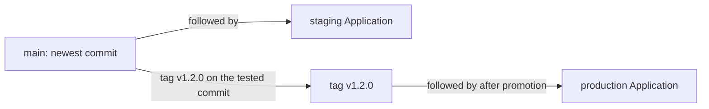

# Promotion, Immutable Artifacts And Secrets

Release 1.2 of `scout` runs in staging and passes its checks. The team now wants production to run exactly what staging ran. This part explains how a release moves from one environment to the next, why the moving parts are the references and the artifacts, and why a secret does not belong in an immutable history.

## What promotion means

**Promotion** moves a release that was tested in one environment to the next environment, without building it again. The thing that is promoted is a pair: the desired state, identified by a commit, and the artifacts it names, identified by image digests or tags. Production receives the same pair that staging proved.

Promotion is a change of a pointer. Two designs are common in a repository with one overlay per environment. In the first, each environment follows a different name. Staging follows the branch `main`, and production follows a tag such as `v1.1.0`. To promote, someone creates a new tag on the tested commit and changes the `targetRevision` of the production `Application` to it. In the second design, the production overlay contains the image tag and the replica count, and promotion is a commit that copies the tested image tag from the staging overlay into the production overlay.



Both designs leave a record. A tag creation or an overlay commit has an author, a time and a message, and it can go through review. The production environment changes only when that record exists.

## Build once, deploy many

An artifact that is rebuilt for each environment is not the artifact that was tested. Two builds of the same source can differ because dependencies resolve differently or the build embeds a timestamp. The record shows the same commit, and the images are different.

The safe pattern is to build the image once, give it an identity, and let every environment reference that identity. A digest is the strongest identity. A version tag that the registry marks as immutable is acceptable. A tag such as `latest`, or a version tag that the build process overwrites, breaks the link between what was tested and what runs.

Configuration follows the same rule. Environment differences belong in the overlays as explicit values. The base stays common, so the difference between staging and production is the content of two small files that a reviewer can read.

## Limits of promotion

A passing staging environment proves what staging exercised. It does not prove that production has the same capacity, the same data volume or the same network policy. Promotion removes one source of variation, which is the build, and does not remove the others.

History needs retention as well. A tag that points at a commit is of no help for recovery if the images it names were deleted from the registry. The team decides how long images and commits stay available, and it keeps that period at least as long as the time during which a rollback may be needed.

## Secrets and immutable history

Immutable history keeps what was committed. A password that was added to a file and removed in the next commit still exists in the earlier commit, in every clone and in every cache of the repository. Deleting the file in a later commit hides it from the current tree and leaves it in the log.

A hash of a commit does not hide its content. Anyone with read access to the repository can read every version of every file.

The practical rules follow from this. Secret values are not committed in plain form. A repository can hold an encrypted representation that only the cluster can decrypt, or a reference to a secret store whose content is read at run time. The reference is versioned and reviewed, and the value follows its own access control and rotation. If a secret was committed by mistake, the credential is treated as compromised and rotated, because removing the file does not remove the value from the history.

## Try it: promote by tag

The playground has the tags `v1.0.0` and `v1.1.0`, and `main` is at release 1.2. Create two `Application` objects. Staging follows `main`. Production follows the tag `v1.1.0`. Save this as `applications.yaml`:

<!-- astrona:playground:renew -->

```yaml
apiVersion: argoproj.io/v1alpha1
kind: Application
metadata:
  name: scout-staging
  namespace: argocd
spec:
  project: default
  source:
    repoURL: http://gitea-http.gitea.svc:3000/starfleet/scout-deploy.git
    targetRevision: main
    path: overlays/staging
  destination:
    server: https://kubernetes.default.svc
    namespace: starfleet-staging
  syncPolicy:
    automated: {}
    syncOptions:
      - CreateNamespace=true
---
apiVersion: argoproj.io/v1alpha1
kind: Application
metadata:
  name: scout-production
  namespace: argocd
spec:
  project: default
  source:
    repoURL: http://gitea-http.gitea.svc:3000/starfleet/scout-deploy.git
    targetRevision: v1.1.0
    path: overlays/production
  destination:
    server: https://kubernetes.default.svc
    namespace: starfleet-production
  syncPolicy:
    automated: {}
    syncOptions:
      - CreateNamespace=true
```

```sh
kubectl apply -f applications.yaml
app_status
```

Both `Application` objects reach `Synced`. Compare what the two environments serve:

```sh
kubectl -n starfleet exec deploy/shuttle -- curl -s http://scout.starfleet-staging/
kubectl -n starfleet exec deploy/shuttle -- curl -s http://scout.starfleet-production/
```

Staging answers with the message `release 1.2` and production with `release 1.1`. The `REVISION` column of `app_status` shows two different commit IDs. Now promote. Tag the commit that staging runs and push the tag. In a clone of the repository:

```sh
git_clone
cd scout-deploy
git tag v1.2.0 main
git push origin v1.2.0
git log --oneline --decorate -n 3
```

Change the name that production follows. The change is the promotion, and in a real setup it goes through review as a commit to the file that holds the `Application`:

```sh
kubectl -n argocd patch application scout-production --type merge -p '{"spec":{"source":{"targetRevision":"v1.2.0"}}}'
app_refresh scout-production
app_status
```

The revision of production now equals the revision of staging, and after the rollout both environments serve `release 1.2`. Check the image that runs in each namespace:

```sh
kubectl -n starfleet-staging get deployment scout -o jsonpath='{.spec.template.spec.containers[0].image}{"\n"}'
kubectl -n starfleet-production get deployment scout -o jsonpath='{.spec.template.spec.containers[0].image}{"\n"}'
```

Both lines show the same image reference, `ghcr.io/stefanprodan/podinfo:6.15.0`. The environment differences that remain are in the overlays: the replica count, the namespace and the label.

## Common pitfalls

> [!WARNING]
> Promotion proves one build, not production readiness. A rebuilt or overwritten image tag breaks the link between what was tested and what runs. A secret that was committed once stays in the history, so rotate it, and do not rely on deleting the file.
