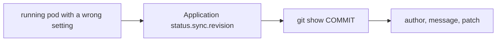

# What The History Records

When production changes, the first question is who changed what, and when, and why. In a GitOps system the answer is in the Git history, because every change to the desired state is a commit. This part shows what a commit stores and which commands turn it into an answer.

## What a commit contains

A **commit** is an object with a fixed set of fields. It points at a **tree**, which is a snapshot of every file at that moment. It lists its **parent** commits, one for a normal commit and two for a merge. It records an **author** with a name, an email address and a time, and a **committer** with the same three fields. It ends with the commit message.

Git names each object by a hash of its content, shown as a 40-character commit id. If any field changes, including the parent, the id changes. Because each commit names its parent, the ids form a chain: a change to an old commit changes every commit after it. This is what makes the history tamper-evident. You can print the raw fields of the newest commit with:

```sh
git cat-file -p HEAD
```

The author is the person who wrote the change. The committer is the person who last applied it, for example the one who rebased it. They are often the same.

## What the history does not prove

Git does not check the author fields. Anyone can run `git config user.name "Dana Whit"` or `git commit --author "Dana Whit <dana@example.com>"`. The name in a commit shows what the committer typed, not who authenticated. The next part explains signatures, which close this gap. Until then, treat the author field as a claim.

## Questions and commands

Each audit question maps to a command.

| Question | Command |
| --- | --- |
| What changed recently? | `git log --oneline -n 10` |
| What did one commit change? | `git show COMMIT` |
| Which commits changed one file, with the patch? | `git log -p -- path/to/file` |
| Who last changed each line? | `git blame path/to/file` |
| What differs between two releases? | `git diff v1.0.0 v1.1.0 -- overlays/production` |
| Which commit added or removed a text? | `git log -S'text' --oneline` |

A custom format prints exactly the fields an audit needs: `git log --format='%H %an %ad %s' -- overlays/production`. The placeholders are the commit id (`%H`), the author name (`%an`), the author date (`%ad`) and the subject line (`%s`).

## From a live object to a commit

Argo CD records which commit it applied. The field `status.sync.revision` of an `Application` holds the commit id of the last comparison, and `status.operationState.syncResult.revision` holds the commit id of the last sync. With that id you can go from a running object to the change that created it, and from there to the author and the review.



The diagram shows the path an investigation follows. It works only if the commit message says why the change was made, so a good message is part of the audit record.

## Messages that help an audit

A commit message has a short subject line and, when needed, a body that explains the reason. Many teams add a reference to the ticket that asked for the change. A message such as `Raise production replicas to 5 for the launch peak` answers the question why. A message such as `fix` does not.

## Try it: answer three questions

<!-- astrona:playground:renew -->

```sh
git_clone
cd scout-deploy
git log --oneline --decorate
```

The list shows the commits of the repository, newest first, with the tags next to the commits they mark. Find the commit that changed the production overlay:

```sh
git log -p -- overlays/production
```

Each commit shows its patch. Now ask who last changed each line of the file and read the full fields of one commit:

```sh
git blame overlays/production/kustomization.yaml
git cat-file -p HEAD
```

The blame output starts each line with a short commit id and the author. The raw commit shows the tree, the parent, the author and the committer.

## What you know now

A commit stores a snapshot, its parents, an author, a committer and a message, and its id depends on all of them. The log commands answer what, when and why, and the revision recorded by Argo CD links a running object to its commit. The author field is not proof of identity, which is the question the next part takes up.

## Common pitfalls

> [!WARNING]
> `git log` without a path shows every commit in the repository. In a repository with several environments, limit the search with a path, or you may attribute a change to the wrong environment.
