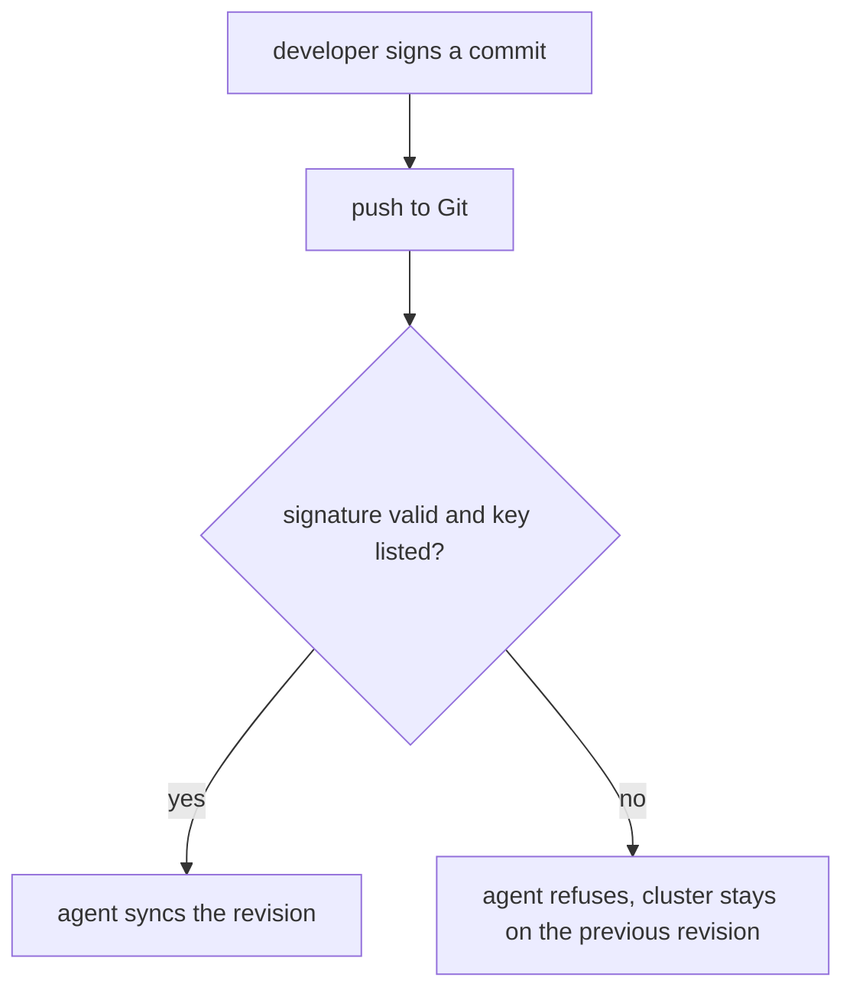

# Signed Commits And Tag Verification

The author of a commit is a name that anyone can type. A system that deploys whatever is on a branch needs stronger evidence. This part explains signatures on commits and tags, and where the GitOps tools can verify them before they apply a change.

## What a signature proves

A **signature** is created with a private key and checked with the matching public key. A signed commit carries the signature in the commit object. Anyone with the public key can check two facts: the commit content has not changed since it was signed, and the holder of the private key signed it.

A signature does not prove that the change is good. It proves who is accountable for it and that nobody altered it afterwards. Together with review, it lets a team say that only changes from known people reach production.

## Signing with Git

Git signs with a GnuPG key by default. Since Git 2.34 it can also sign with an SSH key. The settings below use an SSH key:

```sh
git config gpg.format ssh
git config user.signingkey ~/.ssh/id_ed25519.pub
git config commit.gpgsign true
```

With `commit.gpgsign` set to `true`, every `git commit` signs the commit. You can also sign a single commit with `git commit -S`. Verify signatures with `git log --show-signature` or `git verify-commit COMMIT`. For SSH signatures, Git also needs a file with the allowed public keys, set with `gpg.ssh.allowedSignersFile`, to decide which signers it trusts.

## Annotated and signed tags

A lightweight tag is only a name that points at a commit. An **annotated tag** is a Git object with a tagger, a date and a message. Create it with `git tag -a v1.2.0 -m "Release 1.2.0"`. A **signed tag** is an annotated tag with a signature: `git tag -s v1.2.0 -m "Release 1.2.0"`, verified with `git verify-tag v1.2.0`.

A release tag is the reference that production follows. A signed release tag lets the team show who approved the release. Read an annotated tag with `git show v1.2.0`; it prints the tagger and the message before the commit.

## Where the tools verify

Argo CD supports GnuPG verification. An administrator imports the public keys, for example with the `argocd gpg add` command or in the ConfigMap `argocd-gpg-keys-cm`. A project then lists the accepted key ids in the field `spec.signatureKeys` of the `AppProject`. When an `Application` in that project syncs a revision that is not signed by one of the listed keys, Argo CD refuses the sync and reports an error. The check runs at sync time.

Flux verifies in the `GitRepository` object. The field `spec.verify` has a `mode` that says whether to check the commit at the head of the branch or a tag, and a `secretRef` that holds the public keys. If the check fails, the source controller does not publish the new revision, and the Kustomizations that use it keep applying the previous one.



## Limits

Signature checks need key management: adding keys when people join and removing them when people leave. Argo CD checks GnuPG signatures only, so a team that signs with SSH keys must use GnuPG for the branch Argo CD follows or verify elsewhere. A signature on one commit does not cover the commits before it, so protection of the branch (next part) still matters.

## Try it: annotated tag and signature view

<!-- astrona:playground:renew -->

```sh
git_clone
cd scout-deploy
git tag -a v9.0.0 -m "Release 9.0.0 approved by the platform team"
git show v9.0.0
git log --show-signature -n 2
```

The tag output starts with the tagger and the message. The signature view prints nothing about signatures for these commits, because the playground commits are not signed. Compare a lightweight tag with the annotated one:

```sh
git tag v9.0.1
git cat-file -t v9.0.0
git cat-file -t v9.0.1
```

The first command prints `tag`, an object of its own. The second prints `commit`, because a lightweight tag is only a name for a commit.

## What you know now

A signature ties a commit or tag to a key and proves it was not changed. Git can sign with GnuPG or SSH keys, Argo CD checks GnuPG signatures against the keys listed in an `AppProject`, and Flux checks them in the `GitRepository`. The next question is which changes are allowed to reach the signed branch at all.

## Common pitfalls

> [!WARNING]
> A signature shows who signed, not that the change was reviewed. A person with a valid key can sign a harmful change. Combine signatures with required review.
