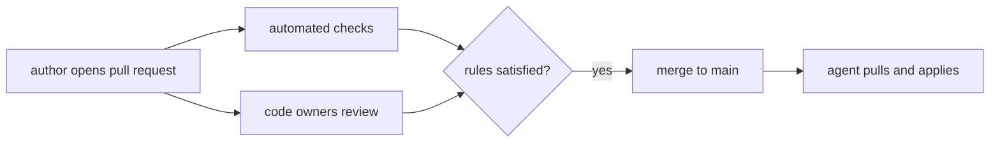

# Review, CODEOWNERS And Branch Protection

In GitOps the branch that the agent follows is the deployment switch. Whoever can write to it can change production. This part explains the controls that decide who may change that branch and how, and why they are part of the audit record.

## The branch is the control point

If Argo CD follows `main` with automated sync, every commit on `main` reaches the cluster within minutes. The permission to push to `main` is therefore the permission to deploy. The access rules of the Git host take the place of the deployment permissions that a push-based pipeline would have in the CI system.

## Pull requests

A **pull request** (called a merge request in GitLab) proposes a change from a branch and collects review before the merge. It records who proposed the change, who reviewed it, the comments and the result of automated checks. This record, together with the merge commit, is the audit trail of the decision.

Automated checks run on the pull request. Typical checks for a configuration repository render the manifests with `kubectl kustomize` or `helm template`, validate them against the Kubernetes schemas, and run policy tests. A broken render is found before the merge and not by the agent after it.

## Branch protection

A **protected branch** has rules that the Git host enforces. The usual rules are:

- No direct pushes: changes arrive only by pull request.
- A number of required approvals, for example one or two.
- Required status checks, which must pass before the merge.
- No force pushes and no deletion of the branch.
- Required signed commits, if the team uses signatures.
- Rules apply to administrators too, where the host allows it.

These settings live in the Git host, not in the repository. A team that treats them as important records them as code where the host supports it, or documents them.

## CODEOWNERS

A `CODEOWNERS` file maps paths to people or teams that must review changes to those paths. For example, `overlays/production/ @starfleet/sre` requires the SRE team to approve changes to the production overlay, while the staging overlay needs no special approval. Git hosts such as GitHub and GitLab read the file and request those reviews automatically. When the branch rule "require review from code owners" is on, the owner approval is mandatory.

This maps the sensitivity of a path to the people who understand it. It also supports separation of duties: the person who writes a production change is not the person who approves it.



## Environments and permissions

If staging and production are folders in the same repository, one rule set covers both, and CODEOWNERS separates them. If production lives in a separate repository or branch, the host can give it different access rules. Either way, the principle is the same: the stricter the environment, the narrower the group that can approve changes to it.

## Emergency changes

A fix during an outage still goes through Git. A team can define a short path with one approver, or an administrator can bypass a rule, and the Git host records the bypass. The change must not be applied by hand in the cluster. With self-heal on, a manual change is reverted, and without it the cluster no longer matches Git.

## Try it: a protected branch without a host

The playground Git server accepts pushes from the user `platform`. Practise the pull request flow with a branch and a diff, since the review features of a Git host are not part of this environment.

<!-- astrona:playground:renew -->

```sh
git_clone
cd scout-deploy
git switch -c raise-production-replicas
sed -i.bak 's/count: 2/count: 3/' overlays/production/kustomization.yaml
rm overlays/production/kustomization.yaml.bak
git commit -am "Raise production replicas to 3 for the launch peak"
git push origin raise-production-replicas
git diff main..raise-production-replicas
```

The branch holds the proposed change and `main` is untouched, so an `Application` that follows `main` does not change. The diff is what a reviewer reads. A merge into `main` is the step that a protected branch would allow only after approval:

```sh
git switch main
git merge --no-ff raise-production-replicas -m "Merge raise-production-replicas"
git push origin main
```

The merge commit records that the change was merged and keeps the branch history visible with `git log --graph --oneline`.

## What you know now

The branch the agent follows is the deployment switch, so access to it is controlled by pull requests, required review and status checks, protection against force pushes, and CODEOWNERS for sensitive paths. The pull request and merge commit are part of the audit record. One action can still damage that record: rewriting history, which the last part covers.

## Common pitfalls

> [!WARNING]
> Branch protection that administrators can bypass silently is not a control. Check which roles can bypass the rules and make the bypass visible in the audit log of the Git host.
