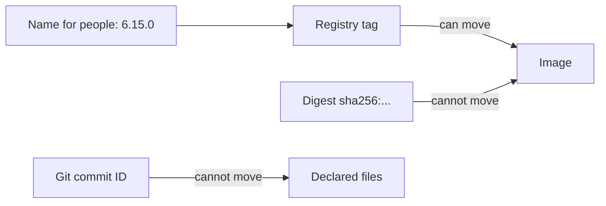

# Versioning Schemes And Identifiers

A release needs a name that people understand and an identifier that cannot change. These are different things. This part explains the common schemes for the first, the identifiers for the second, and how a deployment records both.

## Names for people

**Semantic versioning** writes a version as `MAJOR.MINOR.PATCH`, for example `6.15.0`. A change in the major number signals a break in compatibility. A change in the minor number adds features without a break. A change in the patch number fixes defects. Pre-release versions add a suffix such as `6.16.0-rc.1`. The scheme is a promise made by the author. Nothing in the tools checks it.

**Calendar versioning** uses a date, for example `2026.11` or `2026.11.3`. It tells a reader how old a release is and does not claim anything about compatibility.

A third pattern uses the commit, for example the short ID of the commit that was built. This names the code exactly, but it says little to a reader.

## Identifiers for tools

A name can be reused. A tag in a container registry such as `6.15.0` points at an image today and can be pushed again to point at another image tomorrow. A Git tag can be moved unless the server forbids it.

Content identifiers cannot move. A Git commit ID is a hash of the commit. An image **digest**, written `sha256:` and a long hash, is a hash of the image manifest. A reference with a digest, such as `ghcr.io/stefanprodan/podinfo@sha256:...`, can only ever mean one image.

A common practice is to write both: the tag for the reader and the digest for the tool. Kustomize supports this with the `digest` field under `images`. Helm charts often take a `tag` and an optional `digest` in values.

## Chart version and application version

A Helm chart has two version fields in `Chart.yaml`. `version` is the version of the chart, meaning its templates and defaults. `appVersion` is the version of the application the chart installs. They change independently: a change to a template raises `version`, and a new release of the application raises `appVersion`. When an `Application` pulls a chart, `targetRevision` is the chart version, so it should be an exact number.

## What the declaration should record

For each environment, the declared state should identify:

- the revision of the configuration repository, which the agent records as `status.sync.revision`;
- the image reference, ideally with a digest;
- the chart version, when Helm is used.

With these three, any past deployment can be reproduced.



## Try it: read the identifiers of a running release

<!-- astrona:playground:renew -->

Create an `Application` for the staging overlay with automated sync and wait for `Synced`. Then read the three identifiers:

```sh
kubectl -n argocd get application scout-staging -o jsonpath='{.status.sync.revision}{"\n"}'
kubectl -n starfleet-staging get deploy scout -o jsonpath='{.spec.template.spec.containers[0].image}{"\n"}'
kubectl -n starfleet-staging get pods -l app=scout -o jsonpath='{.items[0].status.containerStatuses[0].imageID}{"\n"}'
```

The first value is the commit of the configuration repository. The second is the image reference with a tag, which a registry can move. The third is the `imageID` that the container runtime resolved, which includes the digest of the image that is actually running.

## What you know now

A version name is for people, and a hash is for tools. Semantic and calendar schemes are conventions, while commit IDs and digests are content identifiers. A chart has its own version apart from the application version. A deployment should record the repository revision, the image digest and the chart version.

## Common pitfalls

> [!WARNING]
> A registry tag is a name that can be moved. Two clusters that pull the same tag at different times can run different images. Record the digest when exact reproduction matters.
