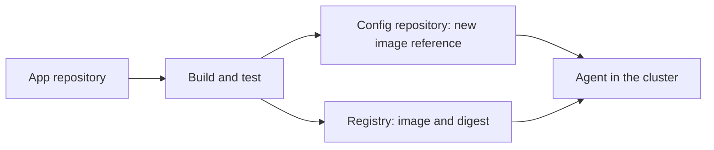

# From Build To Declared State

The path of a release starts in the source repository and ends in a running pod. In GitOps the last step before the cluster is always a commit in the configuration repository. This part follows the path and shows where each check belongs.

## The path

1. A developer merges a change in the **application repository**.
2. A **build** pipeline compiles the code, runs tests and builds a container image.
3. The pipeline **pushes** the image to a registry and receives a tag and a digest.
4. The pipeline, or a person, opens a **change** in the **configuration repository** that sets the new image reference for the first environment.
5. The change is reviewed and merged.
6. The **agent** sees the new commit and applies it.
7. After tests pass, the same image reference is promoted to the next environment by another change.

The pipeline never connects to the cluster. Its only write is a commit in the configuration repository, and the agent does the rest. This matches the pull principle and keeps cluster credentials out of the pipeline.



## Build once, promote the reference

The image is built once. Each environment receives the same image, identified by the same digest or by a tag that is not reused. A rebuild for production would produce a different image from the one that was tested. What differs between environments is the configuration around the image, which comes from the overlay.

## Where the checks belong

The build checks the code: unit tests, image scans and signing. The pull request in the configuration repository checks the deployment: rendering, schema and policy checks, and human review. The environment checks the result: health status and smoke tests. A failed check at one stage stops the path before the next stage.

## Who writes the commit

Three ways exist to write the change that sets the new image reference.

A person edits the file in a pull request. This is slow but gives full control, and fits production.

The pipeline opens a pull request through the API of the Git host. A person approves it.

An automation commits straight to the branch of an environment such as staging. This is the fastest and fits environments where speed matters more than approval. The next part covers it.

In every case the commit carries the author and a message, so the history shows who or what changed the version.

## Try it: simulate a release commit

<!-- astrona:playground:renew -->

```sh
git_clone
cd scout-deploy
sed -i.bak 's/newTag: 6.15.0/newTag: 6.14.0/' overlays/staging/kustomization.yaml
rm overlays/staging/kustomization.yaml.bak
git commit -am "Release 6.14.0 to staging"
git push origin main
```

This stands in for the last step of a pipeline: a change of the image tag in the configuration repository. With an `Application` for the staging overlay and automated sync, the agent applies it:

```sh
app_refresh scout-staging
kubectl -n starfleet-staging get deploy scout -o jsonpath='{.spec.template.spec.containers[0].image}{"\n"}'
```

The pipeline needed no cluster access. Read `git log --oneline -3` to see the release in the history.

## What you know now

A release is a build followed by a commit in the configuration repository. The image is built once and its reference is promoted. The build checks the code, the pull request checks the deployment and the environment checks the result. The pipeline needs write access to the configuration repository, and the agent holds the cluster credentials.

## Common pitfalls

> [!WARNING]
> A pipeline that applies manifests directly with `kubectl` after the commit bypasses the agent and creates two sources of change. Let the commit be the only path.
