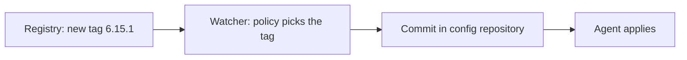

# Image Update Automation

Writing the new image tag into Git by hand for every build is repetitive. Both Flux and Argo CD have components that watch a registry and write the new version into Git. This part explains how they work and what they change about the principles.

## The idea

An **image update automation** watches a container registry for new tags that match a rule, for example the highest semantic version in the range `6.x`. When it finds one, it changes the image reference in the declared state. The point is that the automation changes the declaration in Git, and the agent then deploys it as usual. The history shows each version change as a commit.

## Flux

Flux has two optional controllers for this. They are installed with the `--components-extra` option of `flux bootstrap` or `flux install`: `image-reflector-controller` and `image-automation-controller`.

Three kinds of object work together. An `ImageRepository` tells the reflector which registry repository to scan. An `ImagePolicy` states the rule that picks one tag, for example a semantic version range or an alphabetical order. An `ImageUpdateAutomation` tells the automation controller which Git repository and branch to commit to, and what commit message to use.

In the manifests, a marker comment on the image line links it to a policy. The automation rewrites that value and commits it:

```yaml
image: ghcr.io/example/scout:6.15.0 # {"$imagepolicy": "flux-system:scout"}
```

## Argo CD Image Updater

Argo CD Image Updater is a separate component, not part of the core Argo CD installation. It runs in the cluster, watches the images of the `Application` objects that carry its annotations and, depending on its write-back setting, either writes the new tag into the Git repository or changes the parameters of the `Application` in the cluster.

The write-back to Git keeps the principle that desired state lives in Git. The setting that stores the change only on the `Application` object does not. The new tag then lives in the cluster, and the history in Git no longer shows it. Use the Git method when auditability matters.

## What to decide

Automation moves fast, so a team sets rules.

Which environments update by themselves. Staging often does, production often waits for a pull request.

Which tags qualify. A rule such as "highest `6.x`" is predictable. A rule such as "latest" is not.

Who the commit author is. A dedicated bot identity makes the automated commits easy to find in the history and easy to filter in an audit.

What happens on failure. A bad version still passes through the loop. Health checks and rollbacks, covered in the next part, are the safety net.



## Try it: an automated commit by hand

<!-- astrona:playground:renew -->

The playground does not install the automation components. Act as the automation: choose the newest tag that matches a range, then write it into Git as a bot.

```sh
git_clone
cd scout-deploy
git config user.name "image-bot"
git config user.email "image-bot@starfleet.local"
sed -i.bak 's/newTag: .*/newTag: 6.15.0/' overlays/staging/kustomization.yaml
rm overlays/staging/kustomization.yaml.bak
git commit -am "Update scout image to 6.15.0 (automated)"
git push origin main
git log --format='%an %s' -3
```

The log shows the author `image-bot`. In a real setup the controller creates this commit, and a filter on the bot identity lists every automated version change.

## What you know now

Image update automation writes new versions into Git according to a rule, so the loop stays pull-based and auditable. Flux uses `ImageRepository`, `ImagePolicy` and `ImageUpdateAutomation`. Argo CD uses the separate Image Updater, and its Git write-back keeps the record in the repository. Teams choose which environments update automatically and which tags qualify.

## Common pitfalls

> [!WARNING]
> An automation rule that follows a tag such as `latest` makes the deployed version depend on when the registry was last scanned. Use a version range and write the result into Git.
