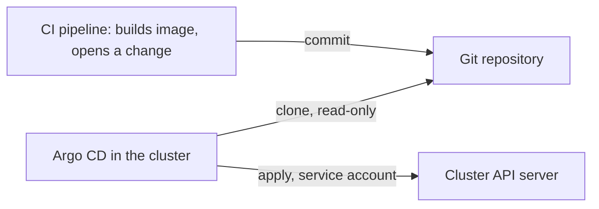

# Push Versus Pull

A CI pipeline builds `scout`, and the release has to reach the cluster. There are two ways to do the last step. The pipeline can run `kubectl apply` against the cluster, or an agent that lives next to the cluster can read the repository and apply what it finds. This part explains the difference in who holds which credential, which network path is open, and what happens after the first deployment.

## The push model

In a **push** model, an external system holds the right to change the cluster. A pipeline job has a kubeconfig, a service account token or a cloud role with permission to create and update objects. When the job runs, it sends the manifests to the Kubernetes API server and exits.

Three consequences follow. The pipeline platform now stores a credential for every cluster it deploys to, and anyone who can read the pipeline secrets or change a job can use that credential. The API server of the cluster must accept connections from the pipeline platform, so a network path from outside into the cluster exists. And after the job exits, nobody watches the cluster. If someone edits an object by hand an hour later, the cluster differs from the repository and nothing notices until the next run.

## The pull model

In a **pull** model, an agent runs where the cluster is. Argo CD is such an agent. It holds a credential to read the repository, and it uses the Kubernetes service account of its own pods to change the cluster it runs in. For another cluster it holds that cluster's credential, stored in Argo CD and not in a pipeline.



The pipeline never talks to the cluster. It writes to the repository, which is a change of desired state and goes through review. The agent reads from the repository and applies. No inbound path into the cluster is needed for deployment: Argo CD makes outbound connections to the Git server.

## What "pull" really requires

Direction on the network is not the definition. A webhook sends an HTTP request from the Git server to Argo CD, which is a connection toward the cluster. The arrangement is still pull, because the request only tells Argo CD that something changed, and Argo CD itself clones the repository and decides what to apply. The test is who holds the authority to change the cluster and who fetches the content.

A pipeline that calls an endpoint of the agent and sends it the manifests in the request body is push, even if the endpoint is inside the cluster. The content then comes from the caller, and there is no independent read from the source of truth.

## Roles and credentials

The pull model separates three roles. The pipeline has write access to the repository, or the right to open a change request, and no access to the cluster. Argo CD has read access to the repository and the cluster rights that its `Application` objects need. People have review rights in the repository.

Each of these should have only the access its role needs. The read credential that Argo CD holds should be read-only, because an agent that only fetches does not need to write. The target rights of Argo CD should be limited by its projects and by the service account permissions. Placing the agent inside the cluster does not make it safe when it runs with unlimited cluster rights.

## Ongoing authority

The first deployment is not the interesting part. The agent keeps running. It compares the repository with the cluster repeatedly, so a missed notification, a restart or an outside change is corrected on the next pass. A push pipeline has a single moment at which it applies. The pull agent has a continuing responsibility, and that is why later parts of the course treat drift and self-healing as part of the same principle.

## Failure and recovery

When the pipeline fails in the push model, the cluster is unchanged and the state is unknown until someone reruns it. In the pull model a failed read leaves the cluster as it was, and the agent retries by itself. A deployment is not lost because a webhook was dropped: the agent finds the commit at its next scheduled check.

## Try it: change the cluster without touching it

The playground has a private repository `scout-deploy` and Argo CD without credentials. The next part adds the credential by hand. For this part, check what is open in the cluster, and look at the `Application` list:

<!-- astrona:playground:renew -->

```sh
kubectl -n argocd get applications
kubectl -n argocd get secrets -l argocd.argoproj.io/secret-type
```

Both commands return nothing: no `Application` and no repository or cluster credential exists yet. Check that Argo CD can already manage its own cluster without a credential Secret:

```sh
kubectl -n argocd get secrets -l argocd.argoproj.io/secret-type=cluster
```

The result is empty. The in-cluster destination `https://kubernetes.default.svc` is always known to Argo CD and uses the service account of its application controller. Look at what that service account may do:

```sh
kubectl auth can-i create deployments -n starfleet-staging --as=system:serviceaccount:argocd:argocd-application-controller
```

The answer is `yes`, because the default installation gives the controller broad cluster rights. This is the authority that has to be limited in a real setup. Now check which Services Argo CD offers inside the cluster. The pull direction only needs Argo CD to reach the Git server, and the other direction is optional:

```sh
kubectl -n argocd get services
```

The list contains `argocd-server`, `argocd-repo-server` and the other components. The component that clones the repository is the repository server, and the component that changes the cluster is the application controller. Two different pods hold the two different jobs: reading Git and writing Kubernetes objects. Check their names:

```sh
kubectl -n argocd get pods -o custom-columns=NAME:.metadata.name,READY:.status.containerStatuses[0].ready
```

No component outside the cluster holds a credential for it, and the `shuttle` pod in `starfleet` is only a client that you use to call workloads.

## What a reviewer should ask

A reviewer who looks at a delivery design can ask four questions. Which system holds a credential that can change the cluster, and where is it stored? Which systems can write to the repository, and what stops them from writing to production without review? What does the agent do when it cannot read the repository? What changes the cluster if someone edits an object by hand? The pull model gives short answers to all four, and the push model gives long ones.

## Common pitfalls

> [!WARNING]
> Network direction does not define pull. If the caller sends the manifests, it is push. Placing the agent in the cluster does not limit its rights: the default controller has broad permissions, so restrict the projects and the service account.
