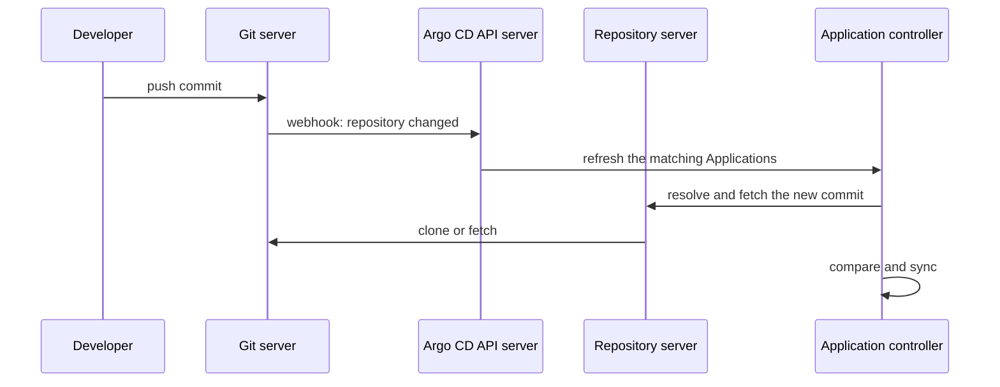

# Polling, Webhooks And Outages

A developer pushes a commit that changes the `scout` message. How long until the cluster shows it, and what happens if the Git server is down at that moment? This part explains how Argo CD finds new commits, how a webhook shortens the wait without changing who is in charge, and how the agent behaves when the source is unavailable.

## Polling

Argo CD does not wait to be told. The application controller refreshes each `Application` on a timer. The default interval is three minutes, set by the `timeout.reconciliation` key of the `argocd-cm` ConfigMap, and Argo CD adds a random offset so that all applications do not refresh at the same instant. At each refresh the repository server resolves `targetRevision` to a commit ID with a lightweight call to the Git server. If the commit ID is the same as before, Argo CD reuses its cached render. If it changed, the repository server fetches the new commit and renders again.

Polling is the baseline. It needs no inbound connection to the cluster and no cooperation from the Git server, and it recovers by itself from any missed signal. Its cost is delay: a commit can wait up to the interval before Argo CD sees it.

## Refresh and hard refresh

A **refresh** makes Argo CD compare the `Application` with its sources again right now. The annotation `argocd.argoproj.io/refresh: normal` requests it, and the value `hard` also discards the cached render and the cached resource state, so everything is read again. Both are requests for fresh evidence. Neither one applies anything on its own: if automated sync is on, a changed comparison result then leads to a sync as usual.

## Webhooks

A **webhook** is an HTTP request that the Git server sends when something happens in a repository. Argo CD exposes the endpoint `/api/webhook` on its API server. A request there that matches the type of the Git host (the format differs between hosts) and refers to a repository and branch that an `Application` uses makes Argo CD refresh those applications at once.



The webhook carries no desired state. The repository server still fetches the commit itself. This is why a webhook does not turn pull into push: the request is a hint that something may have changed, and the content and the decision stay with the agent.

A webhook can fail in several ways. The Git server can be unable to reach Argo CD. A request can be duplicated, delayed or sent for a branch that no application follows. If the Git host and Argo CD share a secret, a request with a wrong secret is rejected. None of these failures loses a commit, because the next poll finds it. A design in which the webhook was the only way to learn about a change would lose the commit when the request is dropped.

## Source outages

When the Git server is unavailable, the repository server cannot resolve or fetch. The application controller then reports an error condition on the `Application`, and the cluster stays as it was. Pods keep running because they do not depend on Git. The `Application` keeps its last known comparison, shown with the error, and the last applied revision stays in `status.sync.revision`.

Argo CD keeps trying at its normal interval. When the Git server returns, the next refresh resolves the revision and any commits that arrived during the outage are applied in one step to the newest one. There is no queue of missed commits to replay, because desired state is the newest revision and not the sequence of changes.

Two limits apply. During the outage no new desired state can reach the cluster, so an urgent fix needs another path or a restored Git server. And the agent cannot tell a Git outage from a revoked credential without reading the condition message.

## Why recovery matters for the principle

An agent that reads the source by itself needs no replay of events. After an outage, a missed webhook or a restart, it asks the source what the desired state is now and acts on the difference. This property is what separates a pulled system from a design that depends on a delivery message arriving.

## Try it: measure the delay and survive an outage

Create the credential and the `Application` from the previous part, or apply both files again: the Secret `secret-repo-scout-deploy.yaml` and the `Application` `application-scout-staging.yaml`. Wait for `Synced`.

<!-- astrona:playground:renew -->

Push a change and watch how long it takes. In a clone of the repository:

```sh
git_clone
cd scout-deploy
perl -pi -e 's/value: staging/value: pulled/' overlays/staging/message.yaml
git commit -am "Staging message: pulled"
git push origin main
```

Check the `Application` every few seconds for up to three minutes:

```sh
app_status
```

At some point the `REVISION` column changes to the new commit. That is the polling interval at work. Repeat with a request for a fresh check:

```sh
perl -pi -e 's/value: pulled/value: pulled-fast/' overlays/staging/message.yaml
git commit -am "Staging message: pulled-fast"
git push origin main
app_refresh scout-staging
app_status
```

The revision changes within seconds. Now add a webhook so that the Git server sends the request by itself. The Git server runs in the cluster and reaches `argocd-server` by its Service name. Create the webhook with the Git server API:

```sh
curl -s -u platform:starfleet-gitops -X POST -H 'Content-Type: application/json' \
  http://127.0.0.1:3000/api/v1/repos/starfleet/scout-deploy/hooks \
  -d '{"type":"gitea","active":true,"events":["push"],"config":{"url":"https://argocd-server.argocd.svc/api/webhook","content_type":"json"}}'
```

Push another commit and check the status without asking for a refresh:

```sh
perl -pi -e 's/value: pulled-fast/value: pulled-hook/' overlays/staging/message.yaml
git commit -am "Staging message: pulled-hook"
git push origin main
app_status
```

The revision changes within seconds of the push, without any refresh from you. Now stop the Git server:

```sh
kubectl -n gitea scale deploy/gitea --replicas=0
app_refresh scout-staging
kubectl -n argocd get application scout-staging -o jsonpath='{.status.conditions[*].message}{"\n"}'
kubectl -n starfleet-staging get deployment scout
```

The condition shows a connection error, and the Deployment is still running. Start the server again and wait for recovery:

```sh
kubectl -n gitea scale deploy/gitea --replicas=1
kubectl -n gitea rollout status deploy/gitea
app_refresh scout-staging
app_status
```

The `Application` is `Synced` again, and nothing in the cluster had to be repaired by hand.

## Common pitfalls

> [!WARNING]
> A webhook is a hint, not a record. Never make it the only way to learn about a change, and keep polling as the fallback. During an outage the cluster keeps its last state, so an urgent change needs a working source or another reviewed path.
