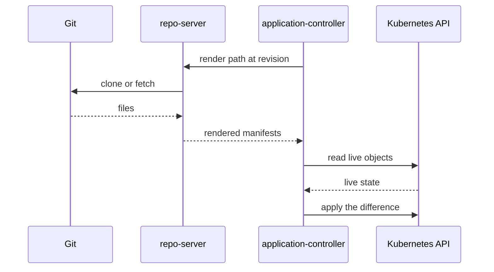

# Argo CD Components

Saying that an agent pulls from Git hides several programs. Each has one job, a different network exposure and a different failure effect. This part names the components of Argo CD, follows one sync through them and shows how to find each one in a cluster.

## The components

Argo CD installs into the namespace `argocd`. The standard installation has these workloads.

The **application controller** is a Kubernetes controller. It watches the `Application` objects and the live objects they manage, compares the desired state with the live state, updates the status and starts syncs. It runs as the StatefulSet `argocd-application-controller`.

The **repository server** is an internal service. It clones the Git repositories, keeps a cache, and renders the manifests with Helm, Kustomize or plain YAML. The Deployment is `argocd-repo-server`. It does not talk to the Kubernetes API of the target cluster.

The **API server** serves the web page, the command-line tool and the REST and gRPC API. It handles login and authorisation and also receives webhooks. The Deployment is `argocd-server`.

**Redis** is a cache for the application state and the rendered manifests (`argocd-redis`). **Dex** (`argocd-dex-server`) provides single sign-on with outside identity providers. The **ApplicationSet controller** (`argocd-applicationset-controller`) generates `Application` objects from templates. The **notifications controller** sends messages on events.

| Component | Kind | Job |
| --- | --- | --- |
| argocd-application-controller | StatefulSet | Compare, sync, report status |
| argocd-repo-server | Deployment | Clone Git, render manifests |
| argocd-server | Deployment | API, web page, login, webhook endpoint |
| argocd-redis | Deployment | Cache |
| argocd-applicationset-controller | Deployment | Generate Applications |

## One sync through the components



The controller asks the repository server for the manifests of a path at a revision. The repository server fetches the repository, renders it and returns the manifests. The controller reads the live objects, computes the difference and applies it. Only the controller and the target cluster API are involved in the apply step.

## What fails when a component stops

If the repository server stops, the controller cannot get new manifests. The `Application` objects show a comparison error and the workloads keep running as they are. If the application controller stops, nothing is compared or synced and the cluster keeps its last state. If the API server stops, the web page, the command line and webhooks fail, and the controller still reconciles from polling. If Redis stops, the system rebuilds its cache and is slower for a while.

This independence is a design choice. The parts that touch Git are separate from the part that has rights in the cluster.

## Where the configuration lives

Settings are in ConfigMaps in the `argocd` namespace. `argocd-cm` holds general settings such as the reconciliation timeout, which defaults to 180 seconds. `argocd-rbac-cm` holds the access policies for users. `argocd-cmd-params-cm` holds the command parameters of the components. The `Application` objects and the repository and cluster Secrets are also stored in the namespace, as Kubernetes objects.

## Try it: find each component

<!-- astrona:playground:renew -->

```sh
kubectl -n argocd get deploy,statefulset
```

Match each name to the table above. The playground install scales the Dex server and the notifications controller to zero because it does not need them. Create an `Application` and follow the sync in the logs of the repository server:

```sh
kubectl apply -f - <<'Y'
apiVersion: argoproj.io/v1alpha1
kind: Application
metadata:
  name: scout-staging
  namespace: argocd
spec:
  project: default
  source:
    repoURL: http://gitea-http.gitea.svc:3000/starfleet/scout-deploy.git
    targetRevision: main
    path: overlays/staging
  destination:
    server: https://kubernetes.default.svc
    namespace: starfleet-staging
  syncPolicy:
    automated: {}
    syncOptions:
      - CreateNamespace=true
Y
kubectl -n argocd logs deploy/argocd-repo-server --tail=20
```

The log lines mention the repository and the revision. Now stop the repository server and watch the effect:

```sh
kubectl -n argocd scale deploy/argocd-repo-server --replicas=0
app_refresh scout-staging
kubectl -n starfleet-staging get deploy scout
kubectl -n argocd scale deploy/argocd-repo-server --replicas=1
```

The Deployment `scout` keeps running while the repository server is down. After the repository server is back, the next refresh succeeds.

## What you know now

Argo CD is a set of programs: a controller that compares and applies, a repository server that clones and renders, an API server for people and webhooks, and a cache. The split keeps the Git access away from the program that has rights in the cluster. The next part shows how Flux splits the same jobs.

## Common pitfalls

> [!WARNING]
> `argocd-server` is not the component that applies changes. Scaling it to zero stops the web page and the command line, and it does not stop reconciliation.
