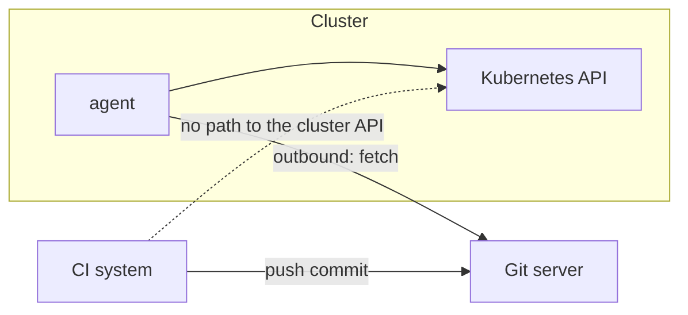

# Network Direction And Cluster Credentials

The security argument for pull-based delivery is about direction. In a push pipeline, an outside system connects to the cluster. In a pull system, the cluster connects out. This part shows which connections the agent opens, which credentials exist and where they are stored.

## Push: the outside reaches in

A push pipeline runs in a CI system. To deploy, the job needs a way to call the Kubernetes API of each target cluster, usually a kubeconfig or a service account token stored as a CI secret. The cluster API must be reachable from the CI system, often from the internet. Anyone who can read the CI secret or change the pipeline can change the cluster.

## Pull: the cluster reaches out

The agent runs inside the cluster, or next to it. It opens outbound connections to the Git server, and optionally to an OCI registry or a Helm repository. It talks to the Kubernetes API of its own cluster over the internal network. Nothing outside has to open a connection to the Kubernetes API.



The CI system can still write to Git and to the registry, so it can still cause a deployment. The difference is that it holds no credential for the cluster. A leak of the CI secrets does not give access to the Kubernetes API.

## What still comes in

Some inbound connections remain, and they are optional. The web page and the API of the agent are reached by people. A webhook from the Git server reaches `argocd-server` at the path `/api/webhook` or a Flux `Receiver`. A webhook only says that something changed. It carries no manifests, and the agent still pulls from Git, so a forged webhook cannot inject a change. At worst it makes the agent check Git early.

## Credentials in a pull system

There are three kinds.

The **repository credential** lets the agent read Git. Use a read-only credential, such as a deploy key or a token with read scope. In Argo CD it is a Secret in the `argocd` namespace with the label `argocd.argoproj.io/secret-type: repository`. In Flux it is a Secret referenced by `spec.secretRef` of the `GitRepository`.

The **cluster credential** lets the agent write to a cluster. For the cluster that the agent runs in, no stored credential is needed: it uses its own service account. In Argo CD that cluster is the destination `https://kubernetes.default.svc`.

For a **remote cluster**, Argo CD stores a credential. The command `argocd cluster add CONTEXT` creates a service account called `argocd-manager` in the remote cluster and stores its token in a Secret with the label `argocd.argoproj.io/secret-type: cluster` in the `argocd` namespace. This is a hub-and-spoke design: one agent manages many clusters, and its Secrets are high-value targets. The other design runs one agent per cluster, so no cluster credential leaves the cluster. Flux uses this design by default, and it can also use a `kubeConfig` reference for remote clusters.

## Network policies

Kubernetes NetworkPolicy objects limit the traffic of pods. A policy for the agent namespace can allow egress to the Git server and the Kubernetes API and deny the rest, and allow ingress to the API server component only from the ingress controller. Some installation manifests of Argo CD ship policies for its components. Check the objects in your cluster with `kubectl -n argocd get networkpolicy`.

## Outages

If the Git server is unreachable, the agent cannot fetch. Delivery of new changes stops, and the running workloads do not stop. With push, a CI outage stops delivery in the same way. The difference is that the pull agent resumes by itself when the connection returns.

## Try it: read the credentials in the cluster

<!-- astrona:playground:renew -->

```sh
kubectl -n argocd get secrets
kubectl -n argocd get secrets -l argocd.argoproj.io/secret-type
kubectl -n argocd get networkpolicy
```

The first command lists the Secrets of the installation. The second lists only repository, cluster and credential-template Secrets. In the playground it may list none, because the repository is public and the agent deploys to the cluster it runs in. Create a repository Secret by hand to see the label at work:

```sh
kubectl -n argocd create secret generic repo-scout --from-literal=type=git --from-literal=url=http://gitea-http.gitea.svc:3000/starfleet/scout-deploy.git
kubectl -n argocd label secret repo-scout argocd.argoproj.io/secret-type=repository
kubectl -n argocd get secrets -l argocd.argoproj.io/secret-type=repository
```

The Secret appears in the filtered list. Argo CD reads such Secrets as repository registrations. No Secret was created for the destination cluster, because `https://kubernetes.default.svc` is the in-cluster address and uses the service account of the controller.

## What you know now

With pull delivery the agent opens outbound connections and the cluster API needs no inbound path from CI. Webhooks are optional hints and carry no manifests. The credentials are a read-only Git credential, none for the home cluster, and a stored token for each remote cluster in the hub-and-spoke design. The remaining question is what the agent may do once it is in the cluster.

## Common pitfalls

> [!WARNING]
> A hub that manages many clusters holds a token for each. Protect the `argocd` namespace as strongly as the clusters themselves, because whoever reads those Secrets can act in every cluster.
