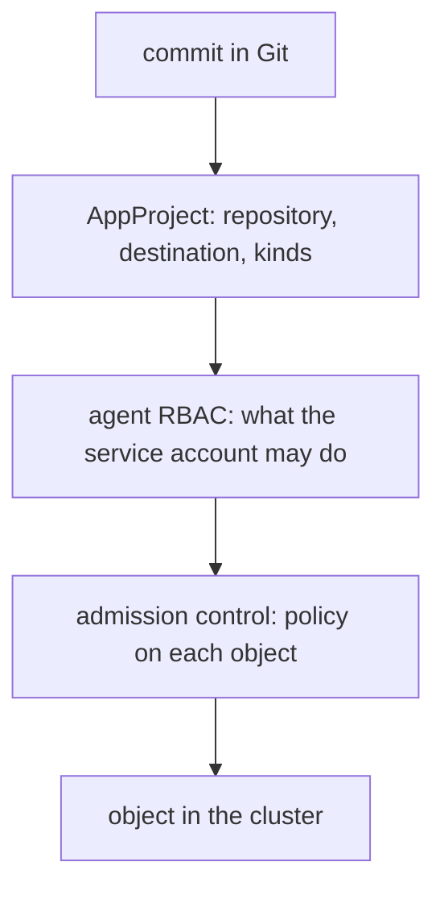

# The Permissions Of The Agent

The agent applies whatever Git says, so its permissions are the ceiling of what a commit can do. This part shows how to read those permissions with standard Kubernetes tools, how the default installation sets them and how to narrow them.

## The agent is a service account

Every pod runs as a Kubernetes **service account**. Permissions come from RBAC objects that bind a role to the account. A `Role` grants verbs on resources inside one namespace. A `ClusterRole` grants them cluster-wide or can be bound inside one namespace. A `RoleBinding` or `ClusterRoleBinding` attaches the role to the service account.

The application controller of Argo CD runs as the service account `argocd-application-controller` in the namespace `argocd`. It is the account that creates, updates and deletes the managed objects. The repository server does not need write access to the cluster.

## The default installation

The cluster-wide manifest `install.yaml` binds a ClusterRole named `argocd-application-controller` to the controller. That role allows every verb on every resource, so the controller can manage any object in any namespace of its cluster. Argo CD needs this because it cannot know in advance which kinds of objects a repository will contain, including custom resources.

The namespaced manifest `namespace-install.yaml` gives the controller Roles only in the `argocd` namespace. The controller can manage objects there, and you register other namespaces on the cluster Secret. That is useful for a team that must not touch cluster-scoped resources.

## Read the permissions

`kubectl auth can-i` asks the API server whether an action is allowed. The option `--as` asks it for another identity:

```sh
kubectl auth can-i delete namespaces --as=system:serviceaccount:argocd:argocd-application-controller
kubectl auth can-i --list --as=system:serviceaccount:argocd:argocd-application-controller
```

The first command answers `yes` or `no` for one action. The second lists every verb and resource that the account is allowed. The format `system:serviceaccount:NAMESPACE:NAME` identifies a service account.

## Narrowing what a commit can do

Narrowing happens in layers.

The first layer is the **AppProject** in Argo CD. A project lists the allowed source repositories, the allowed destinations (cluster and namespace) and the allowed or denied resource kinds. Even if the controller can do everything, an `Application` in a project cannot deploy outside its destinations. The next module describes projects in detail.

The second layer is the permission of the agent in Kubernetes. A namespaced installation, or a role with a list of kinds instead of a wildcard, limits the agent itself.

The third layer is admission control. A validating admission policy or a policy engine can reject objects that break rules, such as privileged pods. It applies to the agent in the same way as to a person.

Flux has a direct way for the second layer: a `Kustomization` can set `spec.serviceAccountName`, and the kustomize controller then impersonates that account when it applies. A team can have a Kustomization that can only touch its own namespace.



## Why this belongs in a GitOps design

The agent's rights replace the rights of the CI deployer. In a push pipeline, a deploy token is scoped to what the pipeline may do. In a pull system, the same decision is made when you install the agent and define projects. A team that installs the agent with full cluster rights and skips projects gives every commit author the ability to change any resource.

## Try it: read the rights of the controller

<!-- astrona:playground:renew -->

```sh
kubectl auth can-i delete namespaces --as=system:serviceaccount:argocd:argocd-application-controller
kubectl auth can-i delete namespaces --as=system:serviceaccount:argocd:argocd-repo-server
```

The first answer is `yes`. The second is `no`, because the repository server only needs to read its own namespace. Look at the binding behind the first answer:

```sh
kubectl get clusterrolebinding argocd-application-controller -o jsonpath='{.roleRef.name} {.subjects[0].name}{"\n"}'
kubectl get clusterrole argocd-application-controller -o jsonpath='{.rules[0].verbs} {.rules[0].resources}{"\n"}'
```

The role is bound to the controller account, and the first rule uses the wildcard `*` for resources and verbs. Now list a narrow account for comparison, the default account of the namespace `starfleet`:

```sh
kubectl auth can-i --list --as=system:serviceaccount:starfleet:default -n starfleet
```

The list is short. It shows the difference between a role designed for one namespace and the controller's wildcard.

## What you know now

The agent is a service account, and its RBAC role sets the ceiling of what any commit can do. The default cluster-wide installation uses a wildcard role, the namespaced installation narrows it, and projects, Flux impersonation and admission policy narrow it further. The module is complete: you know the components, the direction of the connections, the credentials and the permissions of a pull-based agent.

## Common pitfalls

> [!WARNING]
> Access to the Git repository the agent follows is access to everything the agent may do. If the agent has a wildcard role, every committer can change any object in the cluster. Limit the repository access, the projects and the role together.
