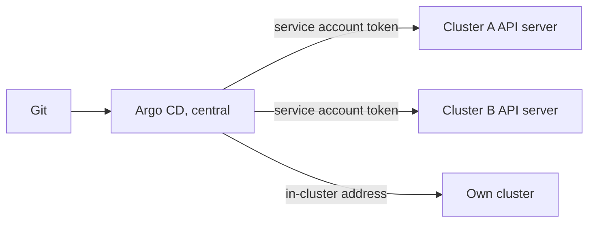

# Registering Clusters

An `Application` names a destination: the cluster and namespace where the objects go. For the cluster that Argo CD runs in, no setup is needed. For any other cluster, Argo CD must be given an address and a credential. This part explains how that registration works and what it means for the pull principle.

## The destination

The destination of an `Application` has a `server` or a `name`, and a `namespace`:

```yaml
destination:
  server: https://kubernetes.default.svc
  namespace: starfleet-staging
```

The address `https://kubernetes.default.svc` is the in-cluster API server address. It refers to the cluster where Argo CD runs and uses the service account of the controller, so no stored credential is needed. A registered remote cluster has its own address, and it can be given a name so that an `Application` refers to `name: prod-eu` instead of the URL.

## Adding a cluster

The command `argocd cluster add <context>` registers the cluster of a kubeconfig context. It creates a service account named `argocd-manager` in the namespace `kube-system` of the target cluster, binds it to a cluster role, and stores the address and the token in a Secret in the `argocd` namespace of the Argo CD cluster.

That Secret carries the label `argocd.argoproj.io/secret-type: cluster`. Registration can also be done declaratively by creating such a Secret directly, which fits a GitOps flow if the Secret is created from an encrypted source. The fields are `name`, `server` and `config`, where `config` holds the credential as JSON.

```sh
kubectl -n argocd get secret -l argocd.argoproj.io/secret-type=cluster
```

If the list is empty, only the in-cluster destination exists. Argo CD lists it in the UI as `in-cluster` without a Secret.

## What the credential can do

The credential in the cluster Secret decides what Argo CD can change in that cluster. The default created by `argocd cluster add` is broad. A team can reduce it by creating a service account with a narrower role in the target cluster and registering that credential instead. The namespaces field of the cluster Secret limits the cluster to named namespaces, which suits a team that owns only part of a cluster.

## Pull or push

In terms of the principle, the important question is who reaches whom. For the in-cluster case, the agent runs next to the objects and reads Git over the network. For a remote cluster registered in a central Argo CD, the central controller connects out to the API server of the remote cluster to read and apply. Git is still the only source of desired state, and the controller still reconciles continuously. The network direction toward the workload cluster is the same as in a push design, which means the workload cluster API server must be reachable from the central one, and the central one holds credentials for every registered cluster. The next part compares topologies that avoid this.



## Try it: list the destinations

<!-- astrona:playground:renew -->

```sh
kubectl -n argocd get secret -l argocd.argoproj.io/secret-type=cluster
kubectl -n argocd get applications -o custom-columns=NAME:.metadata.name,SERVER:.spec.destination.server,NAMESPACE:.spec.destination.namespace
```

The first list is empty because the playground has only the cluster where Argo CD runs. Create an `Application` for the staging overlay and run the second command again. The server column shows `https://kubernetes.default.svc`, which needs no stored credential. Registering a second cluster needs another kubeconfig context, which the playground does not provide.

## What you know now

A destination names a cluster by address or name and a namespace. The in-cluster address needs no credential, and a remote cluster is registered through a Secret with the cluster label. The credential decides what Argo CD may change there. A central controller reaching out to remote clusters keeps Git as the source but holds cluster credentials centrally.

## Common pitfalls

> [!WARNING]
> The cluster Secret is a credential for an entire cluster. Anyone who can read Secrets in the `argocd` namespace can use it. Limit access to that namespace, and prefer a narrow role over the default.
