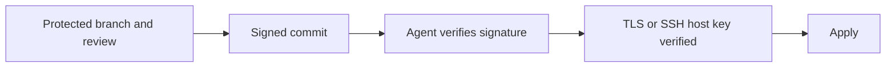

# Trusting The Source

The agent applies whatever the source says. If an attacker changes the source, the agent deploys the change. This part lists the controls that make the source trustworthy, and how the agent can verify what it pulls.

## Control who can change the source

The first control is access to the repository. Only the people and bots that should change a deployment get write access. The branch that the agent follows is protected: pull requests are required, reviews are required, and force pushes are blocked. CODEOWNERS can require an owner of the environment to approve changes to its folder. Credentials of the agent are read-only, so a compromise of the agent does not give write access to Git.

## Verify the commit

Git can sign commits and tags. The agent can refuse a revision that is not signed by a trusted key.

In Argo CD, GnuPG verification is configured in two parts. The public keys that are trusted are imported into the installation, and the `AppProject` lists the key IDs in `spec.signatureKeys`. An `Application` in that project syncs only a revision whose commit is signed with one of those keys. An unsigned commit makes the comparison fail with a condition that names the verification error.

In Flux, the `GitRepository` has a `spec.verify` section. With `mode: HEAD`, the source controller verifies the signature of the head commit using the public keys stored in a Secret that the section refers to. A source that fails verification is not made available to the other controllers, so nothing is applied.

A signature proves that the holder of the key made the commit. It does not prove that the change was reviewed or correct. It does help when the Git host is the weak point, because an attacker who gains write access still cannot sign.

## Pin what is pulled

A moving reference can change without a commit that a reviewer sees. A branch moves with every commit, which is the purpose. A tag can be moved unless protected. For production, a pinned commit or a protected tag is stronger than a branch. Remote bases and charts should name an exact version, and a chart repository or an OCI registry should be accessed with a verified connection.

## OCI as a source

Both tools can pull desired state from an OCI registry instead of Git. A pipeline builds an artifact from a commit and pushes it. Flux has `OCIRepository` for this, and Argo CD can use an OCI source in an `Application`. Artifacts can be signed with a tool such as Cosign, and the agent can verify the signature. This adds a step, but the artifact is immutable and does not depend on the Git host at deploy time.

## Verify the connection

The connection to the source is verified through TLS. For a Git server with a private certificate authority, the certificate or the authority is added to the agent. For SSH, the host key of the server is registered, so that the agent does not trust a server that merely claims to be the host. Disabling verification to make a connection work leaves the pull open to interception.



## Try it: see what the agent trusts

<!-- astrona:playground:renew -->

```sh
kubectl -n argocd get appproject default -o jsonpath='{.spec.signatureKeys}{"\n"}'
kubectl -n argocd get configmap argocd-gpg-keys-cm -o jsonpath='{.data}{"\n"}'
kubectl -n argocd get configmap argocd-ssh-known-hosts-cm -o name
```

The first two commands print empty values: the default project requires no signed commits and no keys are imported. The third shows that the ConfigMap with trusted SSH host keys exists. The playground reaches Git over plain HTTP inside the cluster, which is acceptable only because the traffic never leaves the cluster. A real Git server should be reached over TLS or SSH with verification.

## What you know now

A trustworthy source has controlled write access, a protected branch and read-only agent credentials. Signature verification lets the agent refuse unsigned revisions: Argo CD through `signatureKeys` in the project, Flux through `spec.verify` on the `GitRepository`. Pinning references and verifying the connection close other gaps. OCI artifacts offer an immutable alternative source.

## Common pitfalls

> [!WARNING]
> Skipping certificate or host key verification to get a connection working removes the protection that the pull model relies on. Add the authority or the host key instead.
