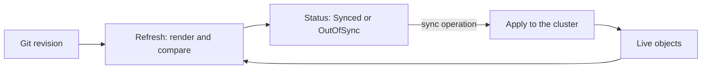

# Drift And Refresh

During an incident, a person scales the `scout` Deployment from one replica to five with `kubectl scale`. The repository still says one. The incident ends and nobody changes it back. This part explains what Argo CD sees in that case, how it decides that something differs, and which operation reads the state and which one changes it.

## What drift is

**Drift** is a difference between the desired state in the repository and the live state in the cluster that nobody declared. A manual edit, a script that bypasses Git or a controller that writes a field that the repository also sets can all cause it. Drift is not an error in itself. It is a fact that a record and reality no longer agree.

Without a program that looks, drift stays unnoticed until the next deployment overwrites it or an outage reveals it. A reconciling agent turns it into visible state: the `Application` reports it, and a policy decides whether the agent corrects it.

## How Argo CD compares

The application controller takes the manifests that the repository server rendered and the live objects that it watches through the Kubernetes API. For each object it compares the two. The comparison is a structural diff, not a text diff of files. It ignores values that Kubernetes fills in by itself, such as `status`, resource versions, and defaulted fields, so that a normal object does not look different from its manifest.

The result is stored in the `Application` status. `status.sync.status` is `Synced` when every managed object matches, `OutOfSync` when at least one differs or is missing, and `Unknown` when the comparison could not run. Separately, `status.health.status` is the health of the objects: `Healthy`, `Progressing`, `Degraded`, `Suspended`, `Missing` or `Unknown`. The two are independent. An `Application` can be `Synced` and `Degraded` when the manifests match and the pods crash, and it can be `OutOfSync` and `Healthy` when a harmless difference exists and every pod is ready.

## Refresh and sync are different operations

A **refresh** reads. The controller gets the current revision, renders if needed, reads the live objects and recomputes the comparison. It writes only status. A **sync** writes. It applies the rendered manifests to the cluster, with the effects of the sync options and hooks. A refresh can show `OutOfSync`, and nothing changes in the cluster until a sync runs.



There are two triggers for a refresh. A change of the source, a new commit, makes the desired state different. A change of the live state, an edit in the cluster, makes the actual state different. The controller watches the live objects continuously and recomputes the comparison when they change. It looks at the repository on the polling schedule or when a webhook arrives.

## Sync policy decides who acts

After a comparison, someone must decide to sync. With no automated policy, a person or a pipeline starts a sync. With automated sync, the controller starts it when the `Application` is `OutOfSync` because of a new revision. The next part covers the automated options. Until then, remember that observing and correcting are two decisions.

A manual sync can be started from the interface, from the command line, or by writing the `operation` field of the `Application`. The operation records its phase, its message and the revision it applied in `status.operationState`. This is the record of what the last sync did.

## Reading evidence

For an `OutOfSync` `Application`, three places hold the facts. `status.sync.status` says that a difference exists. `status.resources` lists each managed object with its own sync and health status, so one can find which object differs. `status.operationState` says what the last sync did and whether it succeeded. With these, one can tell a source change, a live change and a failed sync apart.

## Try it: create drift and read it

Create the `Application` without self-heal. Save this as `application-scout-staging.yaml`:

<!-- astrona:playground:renew -->

```yaml
apiVersion: argoproj.io/v1alpha1
kind: Application
metadata:
  name: scout-staging
  namespace: argocd
spec:
  project: default
  source:
    repoURL: http://gitea-http.gitea.svc:3000/starfleet/scout-deploy.git
    targetRevision: main
    path: overlays/staging
  destination:
    server: https://kubernetes.default.svc
    namespace: starfleet-staging
  syncPolicy:
    automated: {}
    syncOptions:
      - CreateNamespace=true
```

```sh
kubectl apply -f application-scout-staging.yaml
app_status
```

Wait for `Synced`. Now change the live Deployment by hand:

```sh
kubectl -n starfleet-staging scale deployment scout --replicas=5
app_status
```

The `Application` becomes `OutOfSync` within seconds, because the controller watches live objects. The five pods keep running: automated sync without self-heal only acts on a new revision. Find the object that differs:

```sh
kubectl -n argocd get application scout-staging -o jsonpath='{range .status.resources[*]}{.kind} {.name} {.status}{"\n"}{end}'
```

The Deployment is `OutOfSync` and the Service is `Synced`. Now ask for a refresh and see that it changes nothing:

```sh
app_refresh scout-staging
kubectl -n starfleet-staging get deployment scout -o jsonpath='{.spec.replicas}{"\n"}'
```

The count is still 5. A refresh only updated the evidence. Now start a sync by writing the operation:

```sh
kubectl -n argocd patch application scout-staging --type merge -p '{"operation":{"sync":{}}}'
kubectl -n argocd get application scout-staging -o jsonpath='{.status.operationState.phase}{"\n"}'
kubectl -n starfleet-staging get deployment scout -o jsonpath='{.spec.replicas}{"\n"}'
```

The phase is `Succeeded` after a moment and the replica count is back to 1. The sync applied the desired state over the live change. Check the last operation:

```sh
kubectl -n argocd get application scout-staging -o jsonpath='{.status.operationState.message}{"\n"}{.status.operationState.syncResult.revision}{"\n"}'
```

The message says that the sync was successful, and the revision is the commit that was applied.

## Common pitfalls

> [!WARNING]
> A refresh only updates evidence and does not apply anything. `Synced` and `Healthy` are separate statuses: manifests can match while pods crash. Automated sync without self-heal leaves a manual change in place until the source changes.
