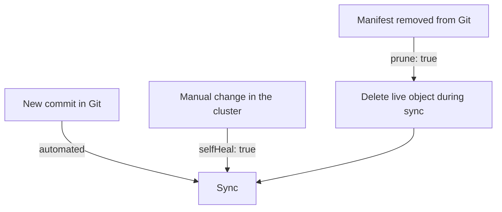

# Automated Sync, Self-Heal And Prune

A manual sync depends on a person who remembers to run it. This part explains the options of the automated sync policy, what each one reacts to, and where automation stops. It uses the three settings `automated`, `selfHeal` and `prune` and the checks that limit them.

## The automated policy

The field `spec.syncPolicy.automated` turns on automated sync. When the `Application` is `OutOfSync` because the desired state changed, the application controller starts a sync by itself. The policy has three parts that are easy to mix up, because each one reacts to a different event.

**Automated** reacts to a change of the source. A new commit leads to a new rendered state, and the controller applies it. This is the minimum for continuous delivery from Git. Without the other two options, it does nothing about live changes and does not delete anything.

**selfHeal** reacts to a change of the live state. When someone edits a managed object in the cluster, the `Application` becomes `OutOfSync` and, with `selfHeal: true`, the controller syncs again and restores the declared values. The default is `false`. The controller waits a short time after a heal, five seconds by default, before it tries again, so a conflict with another writer does not turn into a tight loop.

**prune** reacts to a removal in the source. When a manifest leaves the repository, `prune: true` makes the sync delete the live object that it tracked. The default is `false`, in which case the object stays and the `Application` shows it as requiring pruning.



The diagram shows that the three options are separate switches with separate triggers. A team can turn on any combination.

## Limits of automation

Automated sync tries once for a given commit and parameter set. If a sync fails, for example because a manifest is invalid, the controller does not run the same attempt again and again against the same revision. A new commit, or a manual sync, is needed. The `retry` field of the sync policy changes this: it tells Argo CD to retry a failed sync with a back-off, which fits transient errors such as a webhook that is not ready yet.

Automated pruning refuses to delete everything. If the rendered result contains no resources, the sync is not allowed to remove all existing ones unless `allowEmpty: true` is set. A broken render therefore does not wipe a namespace.

Some objects should never be pruned or healed by the policy. The annotation `argocd.argoproj.io/sync-options: Prune=false` protects one object from pruning. Individual sync options such as `ServerSideApply=true` or `CreateNamespace=true` change how the apply works.

## Healing is ownership

Self-heal says that Git owns the object. A person who edits it by hand during an incident will see the edit disappear within seconds, and that is correct behaviour when the repository is the source of truth. The edit is either reverted or must be made in Git. The team agrees on the process for emergencies: an emergency change is a fast commit, or the team pauses the policy on that `Application` for a short time with a recorded reason.

The decision to heal also depends on risk. A repository that holds production state with `selfHeal` on removes a class of silent changes. A repository with self-heal off keeps the cluster flexible and accepts that drift can accumulate. Neither choice is neutral, and the choice belongs in the repository where it can be reviewed.

## Ownership by another controller

Self-heal is a problem when another controller legitimately writes a field that Git also sets. An autoscaler writes `spec.replicas`. If the repository also says `replicas: 1`, Argo CD heals the count to one and the autoscaler sets it again, in a loop. The next part shows the narrow rule that tells Argo CD to leave that one field alone. The wrong fix is to switch off self-heal for everything.

## Try it: turn on self-heal and prune

Start with the `Application` from the previous part. Self-heal is off. Make the change by hand and see it stay:

<!-- astrona:playground:renew -->

```sh
kubectl apply -f application-scout-staging.yaml
kubectl -n starfleet-staging scale deployment scout --replicas=4
app_status
kubectl -n starfleet-staging get deployment scout -o jsonpath='{.spec.replicas}{"\n"}'
```

The count is 4 and the `Application` is `OutOfSync`. Now turn on self-heal and prune. Save this as `application-scout-staging.yaml`, replacing the older file:

```yaml
apiVersion: argoproj.io/v1alpha1
kind: Application
metadata:
  name: scout-staging
  namespace: argocd
spec:
  project: default
  source:
    repoURL: http://gitea-http.gitea.svc:3000/starfleet/scout-deploy.git
    targetRevision: main
    path: overlays/staging
  destination:
    server: https://kubernetes.default.svc
    namespace: starfleet-staging
  syncPolicy:
    automated:
      prune: true
      selfHeal: true
    syncOptions:
      - CreateNamespace=true
```

```sh
kubectl apply -f application-scout-staging.yaml
kubectl -n starfleet-staging get deployment scout -o jsonpath='{.spec.replicas}{"\n"}'
```

After a few seconds the count returns to 1. The policy change made the controller act on the existing difference. Edit the live object again and watch it revert:

```sh
kubectl -n starfleet-staging scale deployment scout --replicas=3
sleep 15
kubectl -n starfleet-staging get deployment scout -o jsonpath='{.spec.replicas}{"\n"}'
```

The count is 1. The manual edit was undone without any commit. Now test pruning with an object that Git does not describe. Create a ConfigMap by hand. It has no tracking annotation of the `Application`, so Argo CD does not consider it managed:

```sh
kubectl -n starfleet-staging create configmap manual-note --from-literal=text=hello
sleep 10
kubectl -n starfleet-staging get configmap manual-note
```

The ConfigMap is still there. Argo CD only prunes objects that it tracks, and this one has no tracking annotation. Now check the second protection, the `Prune=false` annotation. Add a ConfigMap to the repository base and push it, then remove it again while the annotation is set on the live object:

```sh
git_clone
cd scout-deploy
cat > base/note.yaml <<'YAML'
apiVersion: v1
kind: ConfigMap
metadata:
  name: note
  annotations:
    argocd.argoproj.io/sync-options: Prune=false
data:
  text: keep
YAML
cat > base/kustomization.yaml <<'YAML'
apiVersion: kustomize.config.k8s.io/v1beta1
kind: Kustomization
resources:
  - deployment.yaml
  - service.yaml
  - note.yaml
labels:
  - pairs:
      app.kubernetes.io/part-of: starfleet
YAML
git add -A
git commit -m "Add a ConfigMap that must not be pruned"
git push origin main
app_refresh scout-staging
kubectl -n starfleet-staging get configmap note
```

The ConfigMap exists. Now remove it from Git:

```sh
git rm base/note.yaml
cat > base/kustomization.yaml <<'YAML'
apiVersion: kustomize.config.k8s.io/v1beta1
kind: Kustomization
resources:
  - deployment.yaml
  - service.yaml
labels:
  - pairs:
      app.kubernetes.io/part-of: starfleet
YAML
git add -A
git commit -m "Remove the ConfigMap from Git"
git push origin main
app_refresh scout-staging
sleep 10
app_status
kubectl -n starfleet-staging get configmap note
```

The `Application` is `Synced`, yet the ConfigMap `note` still exists. Prune is on, and the object opted out. Delete it by hand when you are done with it.

## Common pitfalls

> [!WARNING]
> Automated sync, self-heal and prune are three separate switches. Self-heal restores declared values, so a hand edit during an incident disappears, and prune deletes what Git no longer describes. Fix a loop with another controller by narrowing the comparison, and keep self-heal on for the rest.
