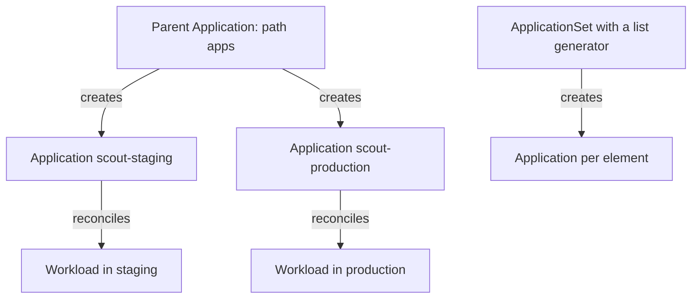

# Ignore Rules And Reconciliation Patterns

Two things can write the same field: Git through Argo CD, and another controller. Many applications also need the same `Application` object repeated for each environment or cluster. This part explains how to tell Argo CD to leave one field alone, how the app-of-apps and ApplicationSet patterns create `Application` objects from Git, and how to find the first layer that failed.

## Ignore rules

An **ignore rule** tells Argo CD to leave out a field when it compares desired and live state. The field `spec.ignoreDifferences` of an `Application` lists the rules. Each rule names a group and kind, optionally a name and namespace, and a way to select fields: `jsonPointers`, which are paths such as `/spec/replicas`, `jqPathExpressions` for fields that need a filter, or `managedFieldsManagers` for the fields that a named manager owns.

```yaml
spec:
  ignoreDifferences:
    - group: apps
      kind: Deployment
      name: scout
      jsonPointers:
        - /spec/replicas
```

With this rule, the comparison treats the replica count of the Deployment `scout` as equal, whatever its value. An autoscaler can change it without making the `Application` `OutOfSync`.

The rule only changes the comparison. When a sync runs for another reason, for example a new commit, Argo CD still applies the complete rendered manifest, and that manifest contains `replicas: 1`. The sync resets the field. The sync option `RespectIgnoreDifferences=true` closes that gap: it makes the sync leave the ignored fields as they are in the live object. The two settings are used together when another controller owns a field.

## Keep the rule narrow

An ignore rule is a hole in the comparison. A rule such as "ignore everything in `/spec` of every Deployment" hides changed images, security settings and routing, which are exactly the differences that drift detection exists to find. A narrow rule names one kind, one name and one field, and has a recorded owner and reason. When the other controller goes away, the rule is removed.

## Many applications from Git

A real platform has dozens of `Application` objects. Writing each one by hand and applying it with `kubectl` leaves them outside Git. Two patterns bring them under the same control.

**App-of-apps** is an `Application` whose source folder holds `Application` manifests. Argo CD treats them like any other resource and creates them in its own namespace. The parent owns the children: removing a manifest from the folder and syncing with prune deletes the child, and a child that someone deletes by hand is created again by the parent.

**ApplicationSet** is a separate resource with its own controller. It has **generators** that produce parameters, for example a list of environments, a list of clusters or the directories of a repository, and a **template** that the controller fills in for each set of parameters. The result is one `Application` per element, kept in line with the generator. Removing an element removes its `Application`.



Each pattern adds a reconciliation layer. The parent or the ApplicationSet controller reconciles the `Application` objects, and each `Application` reconciles its own workload. A problem in one layer does not show up in the other.

## Competing sources of truth

Two `Application` objects that manage the same object, or an `Application` and another tool that apply the same manifest, write to the same fields in turn. The tracking annotation holds only one owner name, so the objects keep changing owners, and the status flips. One owner per object is the rule. A field shared by design needs an ignore rule on one side.

## Diagnose the first failed layer

A failure can sit in any layer between a commit and a running pod. Check them in order. Does the `Application` exist? If not, look at the parent or the ApplicationSet. Does it render? If not, the condition shows a repository or render error. Does it sync? If not, `status.operationState` shows the failed operation and the object. Is it healthy? If not, look at the native objects: events, pods and probes.

A refresh helps only when the evidence is stale. It cannot fix a bad path, a denied permission or a wrong image. A manual sync cannot repair an invalid manifest. Reading the first failed layer avoids actions that cannot work.

## Try it: ignore replicas, then bring up the children from Git

Start with `scout-staging` with self-heal and prune, from the previous part. Save the file as `application-scout-staging.yaml` and apply it:

<!-- astrona:playground:renew -->

```yaml
apiVersion: argoproj.io/v1alpha1
kind: Application
metadata:
  name: scout-staging
  namespace: argocd
spec:
  project: default
  source:
    repoURL: http://gitea-http.gitea.svc:3000/starfleet/scout-deploy.git
    targetRevision: main
    path: overlays/staging
  destination:
    server: https://kubernetes.default.svc
    namespace: starfleet-staging
  syncPolicy:
    automated:
      prune: true
      selfHeal: true
    syncOptions:
      - CreateNamespace=true
```

```sh
kubectl apply -f application-scout-staging.yaml
app_status
kubectl -n starfleet-staging scale deployment scout --replicas=3
sleep 15
kubectl -n starfleet-staging get deployment scout -o jsonpath='{.spec.replicas}{"\n"}'
```

The count returns to 1 because of self-heal. Now add a narrow rule for the replicas and the sync option. Change the file to:

```yaml
apiVersion: argoproj.io/v1alpha1
kind: Application
metadata:
  name: scout-staging
  namespace: argocd
spec:
  project: default
  source:
    repoURL: http://gitea-http.gitea.svc:3000/starfleet/scout-deploy.git
    targetRevision: main
    path: overlays/staging
  destination:
    server: https://kubernetes.default.svc
    namespace: starfleet-staging
  ignoreDifferences:
    - group: apps
      kind: Deployment
      name: scout
      jsonPointers:
        - /spec/replicas
  syncPolicy:
    automated:
      prune: true
      selfHeal: true
    syncOptions:
      - CreateNamespace=true
      - RespectIgnoreDifferences=true
```

```sh
kubectl apply -f application-scout-staging.yaml
kubectl -n starfleet-staging scale deployment scout --replicas=3
kubectl -n starfleet-staging set image deployment/scout scout=ghcr.io/stefanprodan/podinfo:6.14.0
sleep 20
kubectl -n starfleet-staging get deployment scout -o jsonpath='{.spec.replicas} {.spec.template.spec.containers[0].image}{"\n"}'
```

The replica count stays at 3 and the image returns to `6.15.0`. One field is left to its other owner, and every other field is still healed. Now move to the app-of-apps pattern. Remove the single `Application` and create the parent. Save this as `application-starfleet-root.yaml`:

```yaml
apiVersion: argoproj.io/v1alpha1
kind: Application
metadata:
  name: starfleet-root
  namespace: argocd
spec:
  project: default
  source:
    repoURL: http://gitea-http.gitea.svc:3000/starfleet/scout-deploy.git
    targetRevision: main
    path: apps
  destination:
    server: https://kubernetes.default.svc
    namespace: argocd
  syncPolicy:
    automated:
      prune: true
      selfHeal: true
```

```sh
kubectl -n argocd delete application scout-staging
kubectl apply -f application-starfleet-root.yaml
app_status
```

The list contains `starfleet-root` and the two children `scout-staging` and `scout-production`, which came from the folder `apps` in Git. Delete one child by hand:

```sh
kubectl -n argocd delete application scout-production --wait=true
sleep 15
app_status
```

The child comes back, because the parent owns it. Now replace the pattern with an ApplicationSet. Delete the parent and the children, which removes their workloads through the finalizer, and apply the set from the repository:

```sh
kubectl -n argocd delete application starfleet-root
kubectl -n argocd delete application scout-staging scout-production
git_clone
kubectl apply -f scout-deploy/appset/scout-environments.yaml
kubectl -n argocd get applicationsets
app_status
```

The set generates the same two `Application` objects from its list. Last, read the first failed layer for a broken child. Break the path of a generated `Application` in the template by editing the set:

```sh
kubectl -n argocd patch applicationset scout-environments --type json -p '[{"op":"replace","path":"/spec/template/spec/source/path","value":"overlays/{{environment}}-missing"}]'
sleep 10
kubectl -n argocd get application scout-staging -o jsonpath='{.status.conditions[*].message}{"\n"}'
```

The `Application` exists, so the generating layer worked. Its condition names the path that does not exist, so the failing layer is the render. Restore the set with `kubectl apply -f scout-deploy/appset/scout-environments.yaml`.

## Common pitfalls

> [!WARNING]
> An ignore rule without `RespectIgnoreDifferences=true` only hides the difference, and the next sync resets the field. A broad rule hides real drift. Two owners for one object flip it back and forth, and a refresh cannot fix a bad path or a denied permission.
