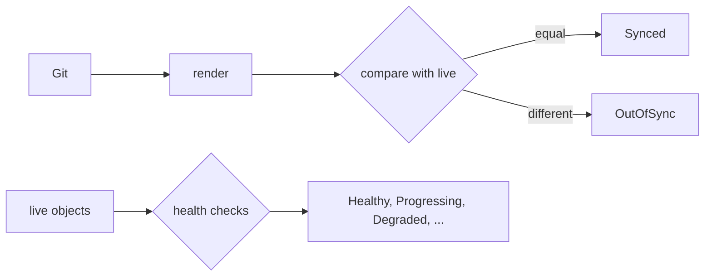

# Sync Status And Health Status

A reconciler answers two different questions: does the cluster match Git, and does what runs there work? Argo CD reports the answers in two separate fields. This part defines each status, explains how health is decided for each kind of object and shows why both are needed.

## Two questions, two statuses

The **sync status** compares the desired state rendered from Git with the live state. It has three values. `Synced` means they match. `OutOfSync` means they differ. `Unknown` means Argo CD could not compare, for example because the render failed.

The **health status** says whether the live objects work. It has six values. `Healthy` means the object is fully working. `Progressing` means it is not healthy yet but may become so. `Degraded` means it failed or timed out. `Suspended` means it is paused, for example a CronJob that is suspended. `Missing` means the object does not exist. `Unknown` means there is no health check for the type.

The two are independent. A Deployment whose image tag does not exist is `Synced`, because the cluster has exactly what Git declares, and it is `Degraded`, because the pods never start. A Deployment that someone scaled by hand is `OutOfSync` and `Healthy`.

| Sync | Health | Meaning |
| --- | --- | --- |
| Synced | Healthy | The goal state |
| Synced | Degraded | Git is applied and the result fails |
| OutOfSync | Healthy | Running fine, but not what Git says |
| OutOfSync | Degraded | Both problems |

## How health is decided

Argo CD has built-in health checks for common types. A Deployment, StatefulSet, DaemonSet or ReplicaSet is healthy when the controller reports the desired number of updated and available replicas. A Deployment is `Progressing` while it rolls out and `Degraded` when `progressDeadlineSeconds` passes without progress. A Service of type LoadBalancer is healthy when an address is assigned. An Ingress is healthy when it has an address. A PersistentVolumeClaim is healthy when it is bound. A Job is healthy when it completes.

The health of an `Application` is the worst health among its resources. One degraded Deployment makes the whole `Application` `Degraded`.

For custom resources, Argo CD has no built-in knowledge unless the resource is covered by its bundled checks. You can add a **custom health check** written in Lua, in the ConfigMap `argocd-cm`, under a key such as `resource.customizations.health.cert-manager.io_Certificate`. The script reads the `status` of the object and returns a status and a message. Without a check, a custom resource is treated as healthy as soon as it exists.

## The resources view

Each `Application` lists its resources with their individual statuses in `status.resources`. Read one line per resource:

```sh
kubectl -n argocd get application scout-staging -o jsonpath='{range .status.resources[*]}{.kind} {.name} {.status} {.health.status}{"\n"}{end}'
```

The fields are the kind, the name, the sync status and the health status of each resource. This is the first place to look when the `Application` as a whole is not green.

## Why health matters for GitOps

Synced is not the goal; a working system is. If a pipeline stops at `Synced`, a broken release counts as a success. The health status lets the sync wait for the new objects to work before it moves on, which the next part uses for ordering. It also feeds alerts and rollouts.



## Try it: Synced but Degraded

<!-- astrona:playground:renew -->

```sh
git_clone
cd scout-deploy
sed -i.bak 's/newTag: 6.15.0/newTag: 6.99.0/' overlays/staging/kustomization.yaml
rm overlays/staging/kustomization.yaml.bak
git commit -am "Use a tag that does not exist"
git push origin main
```

Create the `Application` that follows `main` with automated sync (use the manifest from the earlier modules) and look at the two statuses:

```sh
app_status
kubectl -n argocd get application scout-staging -o jsonpath='{range .status.resources[*]}{.kind} {.name} {.status} {.health.status}{"\n"}{end}'
```

The sync status becomes `Synced`. The Deployment is `Progressing` first and `Degraded` after the progress deadline of the Deployment passes. The pod shows `ErrImagePull` or `ImagePullBackOff`:

```sh
kubectl -n starfleet-staging get pods
```

Fix the tag in Git with a new commit and watch the health change to `Healthy` without any other action.

## What you know now

Sync status compares Git and the cluster. Health status asks whether the objects work. They vary independently, health is decided per type and the `Application` takes the worst value. The next part uses health to control the order of a sync.

## Common pitfalls

> [!WARNING]
> A green `Synced` does not mean a successful release. Always read the health status. A custom resource without a health check shows as healthy even when its controller reports an error.
