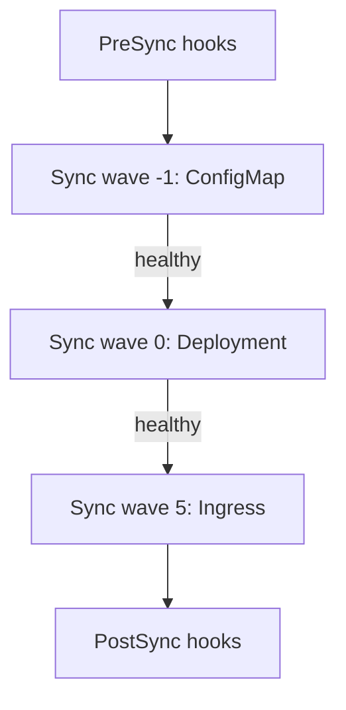

# Sync Phases, Waves And Hooks

A plain `kubectl apply` of a directory sends all objects at once. Real releases often need an order: a database migration before the new version, a namespace before the objects in it. This part explains the three tools Argo CD gives for ordering a sync: phases, waves and hooks.

## Phases

A sync runs in phases. `PreSync` runs before the main apply. `Sync` is the main apply of the manifests. `PostSync` runs after all resources in the sync are healthy. `SyncFail` runs when the sync fails. `PostDelete` runs after the `Application` is deleted.

Objects without a hook annotation belong to the `Sync` phase. A **hook** is an object with the annotation `argocd.argoproj.io/hook` set to a phase name. Hooks are usually Jobs, but they can be any object. A hook is created at its phase and is not part of the compared state afterwards.

```yaml
apiVersion: batch/v1
kind: Job
metadata:
  name: migrate-schema
  annotations:
    argocd.argoproj.io/hook: PreSync
    argocd.argoproj.io/hook-delete-policy: HookSucceeded
spec:
  template:
    spec:
      restartPolicy: Never
      containers:
        - name: migrate
          image: curlimages/curl:8.22.0
          command: ["sh", "-c", "echo running the migration"]
```

The delete policy decides when the hook object is removed. `HookSucceeded` removes it after it succeeds. `HookFailed` removes it after it fails. `BeforeHookCreation` removes the old one before a new run, and it is the default.

If a `PreSync` hook fails, the sync stops before the main apply, and the running workload stays unchanged. This is the protection that makes a migration hook useful.

## Waves

A **sync wave** is an integer in the annotation `argocd.argoproj.io/sync-wave`. The default is `0`. Argo CD applies the resources of the lowest wave first and waits until they are healthy before it starts the next wave. Waves can be negative.

Within one phase, the order is: wave number first, then the kind (namespaces, then other core types, then custom resources), then the name. After a wave becomes healthy, Argo CD waits a short delay, two seconds by default, before the next wave, to let the cluster settle.



Waves also apply to hooks. A `PreSync` hook with wave `-1` runs before one with wave `0` in the same phase.

## What waves do not do

Waves order a single sync. They do not make a resource wait for another one later. If a Deployment depends on a database that is created by another `Application`, the order between the `Application` objects is a different matter. You can give the `Application` objects sync waves inside an app-of-apps parent, because the parent treats them as resources.

Because a wave waits for health, a resource that never becomes healthy blocks all later waves. A missing health check on a custom resource means the wave does not block, which can order the apply but not the readiness.

## Flux

Flux orders at the level of the `Kustomization`. The field `spec.dependsOn` makes one `Kustomization` wait until another is ready. Within a `Kustomization`, `spec.wait: true` makes Flux wait for all applied resources to become ready, and `spec.healthChecks` lists specific objects to wait for. Flux does not have per-object waves.

## Try it: order a ConfigMap before a Deployment

<!-- astrona:playground:renew -->

```sh
git_clone
cd scout-deploy
cat > base/settings.yaml <<'Y'
apiVersion: v1
kind: ConfigMap
metadata:
  name: scout-settings
  annotations:
    argocd.argoproj.io/sync-wave: "-1"
data:
  note: applied first
Y
sed -i.bak 's/  - service.yaml/  - service.yaml\n  - settings.yaml/' base/kustomization.yaml
rm base/kustomization.yaml.bak
git add -A
git commit -m "Add a ConfigMap in wave -1"
git push origin main
```

Create the `Application` and sync it. Then read the order from the operation result:

```sh
kubectl -n argocd get application scout-staging -o jsonpath='{range .status.operationState.syncResult.resources[*]}{.syncPhase} {.kind} {.name}{"\n"}{end}'
```

Each line shows the phase, the kind and the name. Next add a hook. Create the file `base/presync-job.yaml` with the Job shown above, add it to `base/kustomization.yaml` and push. After the next sync, the Job runs first:

```sh
kubectl -n starfleet-staging get jobs
```

The Job object appears only while the hook runs, and `HookSucceeded` removes it after it succeeds.

## What you know now

Phases split a sync into before, during and after. Hooks run jobs at a phase, and waves order resources inside a phase using health as the gate. A failed hook stops the sync before the main apply. The next part covers what happens after a failure.

## Common pitfalls

> [!WARNING]
> A hook that fails every time blocks every sync of the `Application`. Keep hooks idempotent and short, and set a delete policy so that old hook objects do not collide with new ones.
