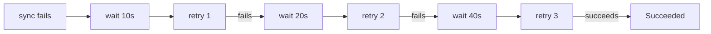

# Retries And Failed Syncs

A sync can fail for a reason that goes away by itself: a webhook that is not ready yet, a custom resource definition that is still being created, a short network error. A reconciler needs a rule for when to try again. This part explains what a failed sync looks like in Argo CD, what the automated policy does after a failure and how to configure retries.

## The operation

A sync is an **operation** on the `Application`. The field `status.operationState` records the last one. Its `phase` is `Running` while the sync is in progress, `Succeeded` when it finished well, `Failed` when a resource or hook failed, and `Error` when the sync itself could not run. The `message` field gives the reason, and `syncResult.resources` lists the result of each resource.

```sh
kubectl -n argocd get application scout-staging -o jsonpath='{.status.operationState.phase} {.status.operationState.message}{"\n"}'
```

## What automated sync does after a failure

Automated sync starts a sync when the `Application` is `OutOfSync`. It starts one attempt for each unique combination of revision and parameters. If that attempt fails, automated sync does not start another attempt for the same revision. The `Application` stays `OutOfSync` with a failed operation until something changes: a new commit, a changed parameter or a manual sync.

With self-heal enabled, a change in the live state can start a new attempt. The controller waits a short time between heal attempts, by default five seconds, to avoid a tight loop.

This default is deliberate. Repeating a sync that fails for a permanent reason, such as a wrong value, fills the logs and hits the API server for nothing. But it also means a short outage can leave an `Application` failed until someone acts.

## The retry policy

The field `spec.syncPolicy.retry` adds retries to a sync that failed.

```yaml
spec:
  syncPolicy:
    automated: {}
    retry:
      limit: 5
      backoff:
        duration: 10s
        factor: 2
        maxDuration: 3m
```

`limit` is the number of retries. A value of `0` means no retries, and a negative value means unlimited. `backoff.duration` is the wait before the first retry. `factor` multiplies the wait after each retry. `maxDuration` caps the wait. With the values above, the waits are 10, 20, 40, 80 and 160 seconds, and none reaches the cap of three minutes.

This pattern is called **exponential backoff**. It retries quickly in case of a short problem and slows down so a long problem does not generate load. When the retries are used up, the operation stays `Failed`.



## Options that reduce failures

Some failures are common enough to have a sync option. `CreateNamespace=true` creates the target namespace. `SkipDryRunOnMissingResource=true` skips the dry run for a custom resource whose definition is created in the same sync. `Validate=false` skips client-side validation. `PruneLast=true` deletes pruned objects after the others are healthy. `ApplyOutOfSyncOnly=true` applies only the objects that differ, which is faster for large applications.

## Rollback

`argocd app rollback` can deploy an earlier entry of the deployment history, but only when automated sync is off, because otherwise automated sync would immediately reapply Git. In a GitOps flow, the better rollback is a revert commit in Git. The desired state then states the earlier version again, and the retry and health rules apply to it like to any change.

## Flux

Flux retries by design. A `Kustomization` that fails is retried at the next `interval`, and the optional `spec.retryInterval` sets a different interval for retries after a failure. The `spec.timeout` limits how long one reconcile may take, including health checks. There is no operation record: the failure appears in the `Ready` condition of the object.

## Try it: fail, then retry

<!-- astrona:playground:renew -->

Create an `Application` that follows `main` and add a retry policy. The overlay needs to fail on purpose. Add a manifest with a mistake to the repository:

```sh
git_clone
cd scout-deploy
cat > base/broken.yaml <<'Y'
apiVersion: v1
kind: ConfigMap
metadata:
  name: broken
data:
  value: 1
Y
sed -i.bak 's/  - service.yaml/  - service.yaml\n  - broken.yaml/' base/kustomization.yaml
rm base/kustomization.yaml.bak
git add -A
git commit -m "Add a ConfigMap with a number as a value"
git push origin main
```

A ConfigMap value must be a string, so the API server rejects the number `1`. Create the `Application` with this policy, then read the operation:

```sh
kubectl -n argocd patch application scout-staging --type merge -p '{"spec":{"syncPolicy":{"retry":{"limit":3,"backoff":{"duration":"10s","factor":2,"maxDuration":"1m"}}}}}'
kubectl -n argocd get application scout-staging -o jsonpath='{.status.operationState.phase} {.status.operationState.retryCount} {.status.operationState.message}{"\n"}'
```

The phase shows `Failed` or `Running` during a retry, `retryCount` rises and the message holds the error from the API server. After the limit is used, the operation stays `Failed`. Fix the value with a quoted string, push the commit and the next sync succeeds.

## What you know now

A sync is an operation with a phase and a message. Automated sync makes one attempt per revision and parameters, and the retry policy adds attempts with exponential backoff. A rollback in GitOps is a revert commit. Flux retries at its interval and shows failures in the `Ready` condition. The last part shows how to observe all of this.

## Common pitfalls

> [!WARNING]
> An unlimited retry (`limit: -1`) on a permanent error repeats forever. Set a limit, and use the failed operation as the signal that someone must change Git.
