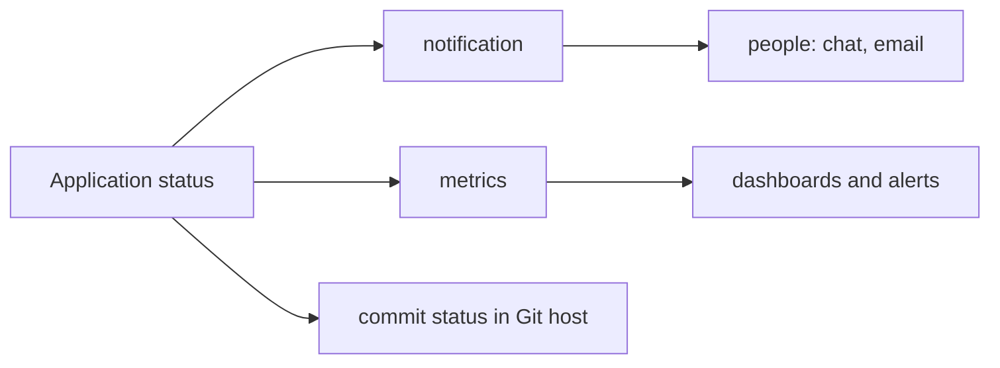

# Observing Reconciliation

A loop that nobody can see fails silently. This part lists the places where Argo CD and Flux report what they do, from a single `Application` to metrics for a whole platform, and shows an order in which to look when something is wrong.

## Look at the object first

The cheapest information is in the object. For an `Application`, read these fields.

`status.sync.status` and `status.health.status` give the two statuses. `status.sync.revision` gives the commit that was compared. `status.conditions` lists problems with a type and a message: `ComparisonError` when the render or comparison fails, `InvalidSpecError` for a wrong `Application` spec, `SyncError` for a failed sync and `OrphanedResourceWarning` for objects in the namespace that no `Application` owns. `status.operationState` describes the last sync. `status.history` lists the deployed revisions.

```sh
kubectl -n argocd get application scout-staging -o jsonpath='{range .status.conditions[*]}{.type}: {.message}{"\n"}{end}'
```

For Flux, `flux get sources git` and `flux get kustomizations` print the ready state and the last message. `flux events` lists the Kubernetes events of the Flux objects.

## Events and logs

Kubernetes events record actions on objects. `kubectl -n argocd get events --sort-by=.lastTimestamp` shows the recent ones. Argo CD writes events for sync results and for resource updates.

The logs of the components say more. The application controller log shows comparisons and sync steps. The repository server log shows Git and render errors. Read them with `kubectl -n argocd logs statefulset/argocd-application-controller` and `kubectl -n argocd logs deploy/argocd-repo-server`.

A practical order for a problem is: the conditions of the `Application`, then the repository server log for render and Git errors, then the controller log for apply errors, then the events in the target namespace.

## Metrics

Each Argo CD component exposes Prometheus metrics. The application controller publishes `argocd_app_info`, a gauge with labels such as `name`, `sync_status` and `health_status`. A dashboard or an alert can count applications by status. `argocd_app_sync_total` counts syncs by result. The repository server publishes metrics about Git requests and render time, such as `argocd_git_request_total`.

Flux components publish metrics of the form `gotk_reconcile_duration_seconds` and `gotk_reconcile_condition`. The second shows the `Ready` condition of each object, which is the basis for alerts.

Metrics tell you that something is wrong across many applications. The object status tells you what is wrong with one.

## Notifications

The Argo CD notifications controller sends messages when a trigger fires. A **trigger** is a condition such as `on-sync-failed`, `on-sync-succeeded` or `on-health-degraded`. A **template** is the message text. A **service** is the destination: Slack, email, a webhook and others. You subscribe an `Application` with an annotation, for example `notifications.argoproj.io/subscribe.on-sync-failed.slack: team-channel`.

Flux uses `Provider` objects for the destination and `Alert` objects that select the events to send. An `Alert` can filter by event severity and by source object.

## Close the loop with Git

Some notifications go back into Git. A status such as "deployed" can be written to the commit as a commit status, so that the pull request shows whether the change reached the cluster. This closes the feedback loop for the author, who sees the result where the change was made.



## Try it: read the signals

<!-- astrona:playground:renew -->

Create an `Application` and break its path on purpose:

```sh
kubectl apply -f - <<'Y'
apiVersion: argoproj.io/v1alpha1
kind: Application
metadata:
  name: scout-staging
  namespace: argocd
spec:
  project: default
  source:
    repoURL: http://gitea-http.gitea.svc:3000/starfleet/scout-deploy.git
    targetRevision: main
    path: overlays/does-not-exist
  destination:
    server: https://kubernetes.default.svc
    namespace: starfleet-staging
Y
app_status
kubectl -n argocd get application scout-staging -o jsonpath='{range .status.conditions[*]}{.type}: {.message}{"\n"}{end}'
```

The sync status is `Unknown` and the condition `ComparisonError` names the missing path. Confirm in the repository server log, then read the controller metrics:

```sh
kubectl -n argocd logs deploy/argocd-repo-server --tail=20
kubectl -n argocd port-forward svc/argocd-metrics 8082:8082 &
curl -s http://127.0.0.1:8082/metrics | grep '^argocd_app_info'
kill %1
```

The metric line for `scout-staging` has the labels `sync_status="Unknown"` and a health status. Fix the path with `kubectl -n argocd patch application scout-staging --type merge -p '{"spec":{"source":{"path":"overlays/staging"}}}'` and read the metric again.

## What you know now

An `Application` reports its state in statuses, conditions and the last operation. Events and logs add detail in a fixed order of components, metrics show the pattern across many applications, and notifications push the result to people and back into Git. With these signals a continuous loop is not a black box. The module is complete: you can read the statuses, order a sync, retry a failure and find the cause.

## Common pitfalls

> [!WARNING]
> Alerting only on metrics hides small failures, and alerting on every event creates noise. Alert on failed syncs and degraded health, and read the object status for the cause.
